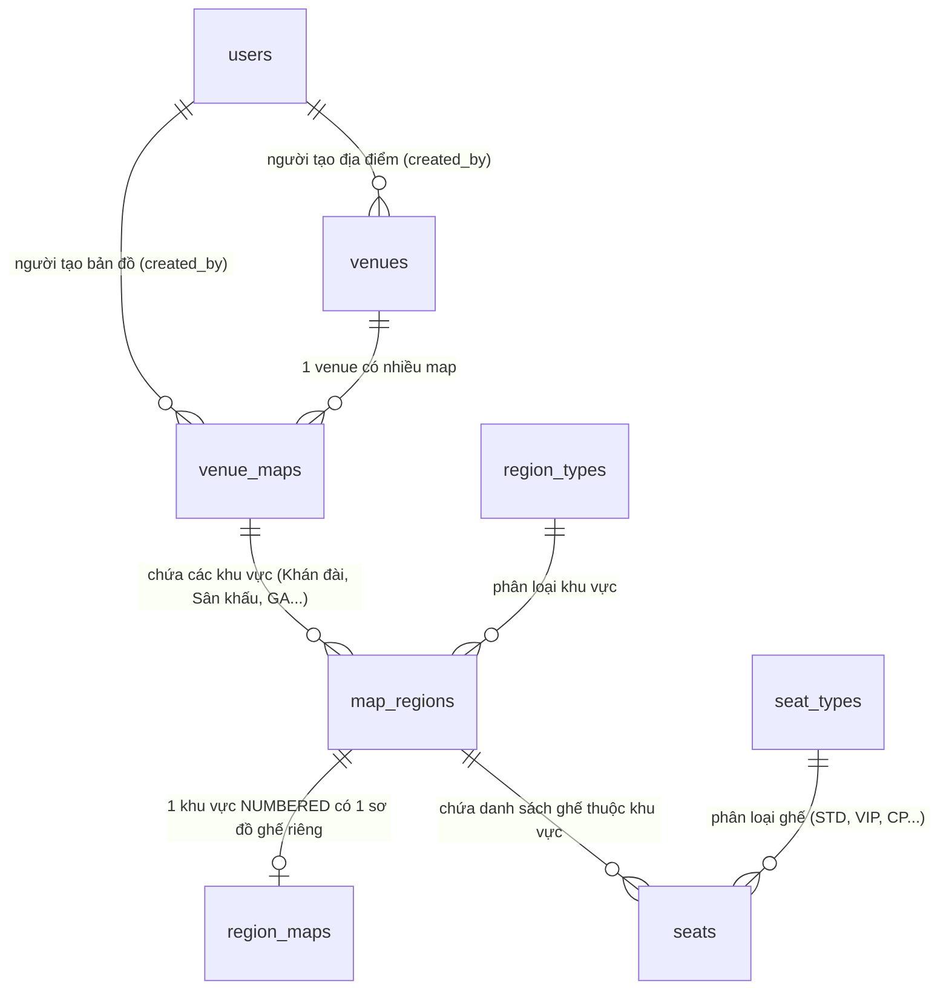

# Kế hoạch Triển khai V2: Venue Management (Kiến trúc Phân cấp 2 Tầng & Thư viện Chia sẻ Mẫu Mặt bằng)

## 1. Bối cảnh & Kiến trúc Sơ đồ Phân cấp 2 Tầng (Hierarchical Two-Level Architecture)

Hệ thống được thiết kế theo mô hình phân cấp 2 tầng độc lập, tích hợp **cơ chế chia sẻ & tái sử dụng tài nguyên (Public/Private Sharing)** giúp các nhà tổ chức (Organizers / Venue Managers) có thể tham khảo, dùng chung hoặc nhân bản (clone) mặt bằng mà không phải tạo lại dữ liệu trùng lặp trong Database:

```
┌──────────────────────────────────────────────────────────────────────────────────────────────────┐
│                   KIẾN TRÚC SƠ ĐỒ PHÂN CẤP 2 TẦNG (TWO-LEVEL HIERARCHICAL MAPS)                  │
├──────────────────────────────────────────────────────────────────────────────────────────────────┤
│                                                                                                  │
│   【 TẦNG 1: TỔNG QUAN ĐỊA ĐIỂM (VENUE OVERVIEW MAP) 】                                          │
│   • Phân quyền sở hữu: Gắn `created_by` (người tạo) + chế độ `visibility` ('PUBLIC' | 'PRIVATE')  │
│     - PUBLIC: Cho phép các người quản lý khác xem, tham khảo và clone lại để tránh tạo trùng DB  │
│     - PRIVATE: Chỉ người tạo và Quản trị viên hệ thống có quyền xem và sử dụng                   │
│   • Thiết kế Figma: Chỉ vẽ ranh giới các khu vực (Khán đài A, B, VIP, Sân khấu, Khu đứng GA)     │
│   • Upload SVG ──► Ingestion Parser Tầng 1:                                                      │
│     - Lưu svg_content và viewBox vào venue_maps                                                  │
│     - Bóc tách danh sách map_regions (seating_type: NUMBERED, STANDING, OPEN_SEATING, NONE)      │
│     - 100% KHÔNG CÓ GHẾ trong file này                                                           │
│   • Hiển thị: Bản đồ tổng thể, người dùng hover/click chọn khu vực                               │
│                                                                                                  │
│                                   │                                                              │
│                   Người dùng click vào khu vực NUMBERED                                          │
│                                   ▼                                                              │
│                                                                                                  │
│   【 TẦNG 2: CHI TIẾT TỪNG KHU VỰC (REGION SEAT MAP) 】                                          │
│   • Thiết kế Figma: Thiết kế sơ đồ ghế riêng cho từng khu vực ghế ngồi số                        │
│   • Upload SVG ──► Ingestion Parser Tầng 2:                                                      │
│     - Lưu svg_content và viewBox vào region_maps (1:1 với map_regions)                            │
│     - Bóc tách chi tiết từng ghế seats (Hàng, Số ghế, Loại ghế, Tọa độ X-Y)                      │
│     - Cập nhật total_seats cho khu vực                                                           │
│   • Hiển thị: Tải riêng sơ đồ của khu vực đó, zoom/pan mượt mà, chọn từng ghế hoặc đổi loại ghế   │
│                                                                                                  │
│   * Lưu ý: Đối với khu vực STANDING hoặc OPEN_SEATING: Chỉ cần cấu hình capacity ở Tầng 1,      │
│            không cần upload sơ đồ Tầng 2.                                                        │
└──────────────────────────────────────────────────────────────────────────────────────────────────┘
```

> **Ý nghĩa cơ chế `created_by` và `visibility` (PUBLIC / PRIVATE)**:
> 1. **Chống lãng phí & trùng lặp dữ liệu**: Các địa điểm phổ biến (SVĐ Mỹ Đình, TT Hội nghị Quốc gia, SVĐ Quân khu 7...) chỉ cần một người vẽ và xuất bản ở chế độ `PUBLIC`. Những người quản lý khác khi tổ chức sự kiện có thể chọn trực tiếp hoặc **Clone** về mà không cần nhập lại địa chỉ, GPS và vẽ lại SVG từ đầu.
> 2. **Bảo mật & Tự do tùy biến**: Người tạo có toàn quyền giữ `PRIVATE` khi đang thiết kế/thử nghiệm hoặc sự kiện riêng tư, và chỉ mở `PUBLIC` khi muốn chia sẻ làm mẫu chuẩn.
> 3. **Phân quyền chặt chẽ**: Chỉ `created_by` (hoặc `ADMIN`/`SUPER_ADMIN`) mới có quyền sửa/xóa/đổi cấu hình. Người khác chỉ có quyền đọc (Read) và nhân bản (Clone).

---

## 2. Quy chuẩn Đặt ID trong File SVG (SVG ID Naming Specification)

Hệ thống phân định rạch ròi 2 bộ quy chuẩn ID tương ứng với 2 loại file SVG:

### A. Quy chuẩn File SVG Bản đồ Tổng thể (`venue_map.svg`)
File này đại diện cho toàn bộ mặt bằng địa điểm, chỉ chứa các khối khu vực (Polygon, Path, Rect):

| Đối tượng | Cú pháp chuẩn (Kebab-case) | Ví dụ thực tế | Ý nghĩa bóc tách |
| :--- | :--- | :--- | :--- |
| **Khu đứng (Standing)** | `region-standing-{tên_khu}` | `region-standing-fanzone`<br>`region-standing-ga1` | • Loại: `STANDING`<br>• Cấu hình `capacity > 0`<br>• Không có sơ đồ ghế Tầng 2 |
| **Khán đài tự do (Arena)** | `region-arena-{tên_khu}` | `region-arena-tang2`<br>`region-arena-stand-b` | • Loại: `OPEN_SEATING`<br>• Cấu hình `capacity > 0`<br>• Không có sơ đồ ghế Tầng 2 |
| **Khu ghế ngồi số (Seated)**| `region-seated-{tên_khu}` | `region-seated-vip-a`<br>`region-seated-tang1` | • Loại: `NUMBERED`<br>• **Sẽ được tải sơ đồ ghế riêng (`region_map`) ở Tầng 2** |
| **Khu phi bán vé** | `region-none-{tên_khu}` | `region-none-stage`<br>`region-none-loi-di` | • Loại: `NONE`<br>• `is_bookable = FALSE` (Sân khấu, lối đi, WC...) |
| **Hình trang trí / Nền** | Bất kỳ tên nào **không có** tiền tố `region-` | `background-map`<br>`stage-decorations`<br>`text-exit-gate` | • **Bỏ qua 100%**, chỉ hiển thị làm đồ họa nền trên canvas |

---

### B. Quy chuẩn File SVG Sơ đồ Chi tiết Khu vực (`region_map.svg`)
File này đại diện cho sơ đồ ghế của 1 khu vực cụ thể (`seating_type = NUMBERED`), chứa các phần tử ghế (<circle>, <rect>, <path>):

| Đối tượng | Cú pháp chuẩn (Kebab-case) | Ví dụ thực tế | Ý nghĩa bóc tách |
| :--- | :--- | :--- | :--- |
| **Ghế ngồi cụ thể** | `seat-{Hàng}-{Số}-{Mã_Loại_Ghế}` | `seat-A-01-VIP`<br>`seat-B-15-STD`<br>`seat-C-02-CP` | • Hàng: `A`, Số: `1`<br>• Loại: `VIP` (Mặc định: `STD`)<br>• Lấy tọa độ vector X, Y thực |
| **Nhóm hàng ghế (Tùy chọn)** | `row-{Hàng}` | `row-A`<br>`row-B` | • Dùng để gom nhóm trực quan trong Figma, parser tự động quét các thẻ `seat-*` bên trong |
| **Đồ họa khu vực** | Bất kỳ tên nào **không có** tiền tố `seat-` | `region-boundary`<br>`aisle-walkway`<br>`exit-indicator` | • **Bỏ qua**, chỉ hiển thị làm đồ họa bối cảnh cho khu vực |

#### Bảng mã viết tắt loại ghế (`seat_type_code`):
* **`STD`** (hoặc để trống): `STANDARD` (Ghế tiêu chuẩn thường)
* **`VIP`**: `VIP` (Ghế VIP)
* **`CP`**: `COUPLE` (Ghế đôi / Sweetbox)
* **`WC`**: `WHEELCHAIR` (Ghế người khuyết tật)
* **`PRM`**: `PREMIUM` (Ghế cao cấp / Recliner / Sofa)

---

## 3. Quy trình Rã File SVG thành Database (Two-Stage SVG Ingestion Pipeline)

```
[ GIAI ĐOẠN 1: INGESTION VENUE MAP ]                [ GIAI ĐOẠN 2: INGESTION REGION MAP ]
    (Upload file SVG tổng thể)                           (Upload file SVG của 1 Region)
                │                                                     │
                ▼                                                     ▼
1. XXE Sanitizer & XML Validation                    1. XXE Sanitizer & XML Validation
                │                                                     │
                ▼                                                     ▼
2. Trích xuất viewBox ──► venue_maps.view_box        2. Trích xuất viewBox ──► region_maps.view_box
                │                                                     │
                ▼                                                     ▼
3. Quét Region Layers (Regex: ^region-...)           3. Quét Seat Elements (Regex: ^seat-...)
   • standing   ──► map_regions (STANDING)              • Bóc tách: row_label, seat_number, type
   • arena      ──► map_regions (OPEN_SEATING)          • Tính tọa độ thực:
   • seated     ──► map_regions (NUMBERED)                  - <circle>: x = cx, y = cy
   • none       ──► map_regions (NONE)                      - <rect>: x = x + w/2, y = y + h/2
                │                                                     │
                ▼                                                     ▼
4. Giao dịch Database:                               4. Giao dịch Database:
   • INSERT/UPDATE venue_maps (svg_content)             • UPSERT region_maps (svg_content)
   • Batch INSERT map_regions                           • Batch INSERT seats (gắn region_id)
   (HOÀN TOÀN KHÔNG CÓ GHẾ Ở BƯỚC NÀY)                  • UPDATE region_maps.total_seats
```

---

## 4. Thiết kế Database Schema Chi tiết (`V2__venue_management.sql`)

### Sơ đồ Thực thể (ERD)



---

### Chi tiết DDL 6 Bảng Dữ liệu

#### 1. `venues` — Địa điểm tổ chức (Có người tạo & Chế độ Chia sẻ)
```sql
CREATE TABLE venues (
    id              UUID            NOT NULL DEFAULT gen_random_uuid(),
    created_by      UUID,                           -- ID người dùng/quản lý tạo địa điểm (NULL nếu hệ thống tạo sẵn)
    name            VARCHAR(200)    NOT NULL,
    address         TEXT            NOT NULL,
    city            VARCHAR(100)    NOT NULL,
    state           VARCHAR(100),
    country         VARCHAR(100)    NOT NULL,
    zip_code        VARCHAR(20),
    latitude        DECIMAL(10,7),
    longitude       DECIMAL(10,7),
    phone           VARCHAR(20),
    email           VARCHAR(255),
    description     TEXT,
    visibility      VARCHAR(20)     NOT NULL DEFAULT 'PRIVATE', -- PUBLIC: Chia sẻ cho mọi quản lý tham khảo | PRIVATE: Nội bộ
    is_active       BOOLEAN         NOT NULL DEFAULT TRUE,
    version         INT             NOT NULL DEFAULT 0,
    created_at      TIMESTAMPTZ     NOT NULL DEFAULT NOW(),
    updated_at      TIMESTAMPTZ     NOT NULL DEFAULT NOW(),
    deleted_at      TIMESTAMPTZ,

    CONSTRAINT pk_venues PRIMARY KEY (id),
    CONSTRAINT fk_venues_creator FOREIGN KEY (created_by) REFERENCES users (id) ON DELETE SET NULL,
    CONSTRAINT ck_venues_visibility CHECK (visibility IN ('PUBLIC', 'PRIVATE')),
    CONSTRAINT ck_venues_latitude CHECK (latitude IS NULL OR (latitude >= -90 AND latitude <= 90)),
    CONSTRAINT ck_venues_longitude CHECK (longitude IS NULL OR (longitude >= -180 AND longitude <= 180))
);

CREATE INDEX idx_venues_city ON venues (city);
CREATE INDEX idx_venues_created_by ON venues (created_by);
CREATE INDEX idx_venues_visibility ON venues (visibility) WHERE deleted_at IS NULL;
CREATE INDEX idx_venues_active ON venues (is_active) WHERE deleted_at IS NULL;
```

#### 2. `region_types` — Bảng phân loại khu vực (Lookup)
```sql
CREATE TABLE region_types (
    code                VARCHAR(30)     NOT NULL,
    name                VARCHAR(100)    NOT NULL,
    description         TEXT,
    is_bookable_default BOOLEAN         NOT NULL DEFAULT FALSE,
    default_seating_type VARCHAR(30)    NOT NULL DEFAULT 'NONE',
    icon                VARCHAR(50),
    color_default       VARCHAR(7),
    display_order       INT             NOT NULL DEFAULT 0,
    is_active           BOOLEAN         NOT NULL DEFAULT TRUE,

    CONSTRAINT pk_region_types PRIMARY KEY (code),
    CONSTRAINT ck_rt_code_upper CHECK (code = UPPER(code)),
    CONSTRAINT ck_rt_default_seating CHECK (default_seating_type IN ('NUMBERED', 'STANDING', 'OPEN_SEATING', 'NONE'))
);
```

#### 3. `seat_types` — Bảng phân loại ghế (Lookup)
```sql
CREATE TABLE seat_types (
    code            VARCHAR(30)     NOT NULL,
    name            VARCHAR(100)    NOT NULL,
    description     TEXT,
    color_default   VARCHAR(7),
    icon            VARCHAR(50),
    display_order   INT             NOT NULL DEFAULT 0,
    is_active       BOOLEAN         NOT NULL DEFAULT TRUE,

    CONSTRAINT pk_seat_types PRIMARY KEY (code),
    CONSTRAINT ck_st_code_upper CHECK (code = UPPER(code))
);
```

#### 4. `venue_maps` — Bản đồ SVG Tổng thể Địa điểm (Level 1, Có người tạo & Chế độ Chia sẻ)
```sql
CREATE TABLE venue_maps (
    id                  UUID            NOT NULL DEFAULT gen_random_uuid(),
    venue_id            UUID            NOT NULL,
    created_by          UUID,                           -- ID người tạo/upload sơ đồ
    name                VARCHAR(200)    NOT NULL,
    description         TEXT,
    svg_content         TEXT,                           -- Mã nguồn SVG tổng quan địa điểm (chỉ chứa các region-*, không chứa ghế)
    view_box            VARCHAR(100)    NOT NULL,       -- viewBox chuẩn SVG (VD: '0 0 1920 1080')
    visibility          VARCHAR(20)     NOT NULL DEFAULT 'PRIVATE', -- PUBLIC: Bản đồ mẫu công khai | PRIVATE: Nội bộ
    status              VARCHAR(20)     NOT NULL DEFAULT 'DRAFT',
    is_active           BOOLEAN         NOT NULL DEFAULT TRUE,
    version             INT             NOT NULL DEFAULT 0,
    created_at          TIMESTAMPTZ     NOT NULL DEFAULT NOW(),
    updated_at          TIMESTAMPTZ     NOT NULL DEFAULT NOW(),

    CONSTRAINT pk_venue_maps PRIMARY KEY (id),
    CONSTRAINT fk_vm_venue FOREIGN KEY (venue_id) REFERENCES venues (id) ON DELETE RESTRICT,
    CONSTRAINT fk_vm_creator FOREIGN KEY (created_by) REFERENCES users (id) ON DELETE SET NULL,
    CONSTRAINT uk_vm_venue_name UNIQUE (venue_id, name),
    CONSTRAINT ck_vm_visibility CHECK (visibility IN ('PUBLIC', 'PRIVATE')),
    CONSTRAINT ck_vm_status CHECK (status IN ('DRAFT', 'PUBLISHED', 'ARCHIVED'))
);

CREATE INDEX idx_vm_venue_id ON venue_maps (venue_id);
CREATE INDEX idx_vm_created_by ON venue_maps (created_by);
CREATE INDEX idx_vm_visibility ON venue_maps (visibility) WHERE is_active = TRUE;
CREATE INDEX idx_vm_status ON venue_maps (status) WHERE is_active = TRUE;
```

#### 5. `map_regions` — Khu vực trong Bản đồ Tổng thể
```sql
CREATE TABLE map_regions (
    id                  UUID            NOT NULL DEFAULT gen_random_uuid(),
    map_id              UUID            NOT NULL,
    region_type_code    VARCHAR(30)     NOT NULL,
    name                VARCHAR(200)    NOT NULL,
    svg_element_id      VARCHAR(100)    NOT NULL,       -- ID thẻ trong SVG venue_map (VD: 'region-seated-vip-a')
    seating_type        VARCHAR(30)     NOT NULL DEFAULT 'NONE',
    capacity            INT,                            -- Bắt buộc > 0 đối với STANDING và OPEN_SEATING
    color_code          VARCHAR(7),
    is_bookable         BOOLEAN         NOT NULL DEFAULT FALSE,
    display_order       INT             NOT NULL DEFAULT 0,
    properties          JSONB           NOT NULL DEFAULT '{}',
    is_active           BOOLEAN         NOT NULL DEFAULT TRUE,
    created_at          TIMESTAMPTZ     NOT NULL DEFAULT NOW(),
    updated_at          TIMESTAMPTZ     NOT NULL DEFAULT NOW(),

    CONSTRAINT pk_map_regions PRIMARY KEY (id),
    CONSTRAINT fk_mr_map FOREIGN KEY (map_id) REFERENCES venue_maps (id) ON DELETE CASCADE,
    CONSTRAINT fk_mr_region_type FOREIGN KEY (region_type_code) REFERENCES region_types (code),
    CONSTRAINT uk_mr_map_name UNIQUE (map_id, name),
    CONSTRAINT uk_mr_map_svg_id UNIQUE (map_id, svg_element_id),
    CONSTRAINT ck_mr_capacity CHECK (capacity IS NULL OR capacity > 0),
    CONSTRAINT ck_mr_seating_type CHECK (seating_type IN ('NUMBERED', 'STANDING', 'OPEN_SEATING', 'NONE')),
    
    -- Ràng buộc 1: Nếu không bán vé thì seating_type = NONE; nếu bán vé thì phải thuộc 3 loại
    CONSTRAINT ck_mr_bookable_seating CHECK (
        (is_bookable = FALSE AND seating_type = 'NONE') OR
        (is_bookable = TRUE AND seating_type IN ('NUMBERED', 'STANDING', 'OPEN_SEATING'))
    ),
    
    -- Ràng buộc 2: Khu vực đứng STANDING và Arena tự do OPEN_SEATING BẮT BUỘC phải có capacity > 0
    CONSTRAINT ck_mr_capacity_required CHECK (
        (seating_type IN ('STANDING', 'OPEN_SEATING') AND capacity IS NOT NULL AND capacity > 0) OR
        (seating_type NOT IN ('STANDING', 'OPEN_SEATING'))
    )
);

CREATE INDEX idx_mr_map_id ON map_regions (map_id);
CREATE INDEX idx_mr_svg_id ON map_regions (map_id, svg_element_id);
```

#### 6. `region_maps` — Sơ đồ SVG Chi tiết của Từng Khu vực (Level 2)
```sql
CREATE TABLE region_maps (
    id                  UUID            NOT NULL DEFAULT gen_random_uuid(),
    region_id           UUID            NOT NULL,
    name                VARCHAR(200),
    svg_content         TEXT            NOT NULL,       -- Mã nguồn SVG chi tiết của riêng khu vực này (chứa các thẻ seat-*)
    view_box            VARCHAR(100)    NOT NULL,       -- viewBox chuẩn SVG của sơ đồ khu vực (VD: '0 0 1200 800')
    total_seats         INT             NOT NULL DEFAULT 0,
    is_active           BOOLEAN         NOT NULL DEFAULT TRUE,
    version             INT             NOT NULL DEFAULT 0,
    created_at          TIMESTAMPTZ     NOT NULL DEFAULT NOW(),
    updated_at          TIMESTAMPTZ     NOT NULL DEFAULT NOW(),

    CONSTRAINT pk_region_maps PRIMARY KEY (id),
    CONSTRAINT fk_rm_region FOREIGN KEY (region_id) REFERENCES map_regions (id) ON DELETE CASCADE,
    CONSTRAINT uk_rm_region UNIQUE (region_id)          -- Quan hệ 1:1, mỗi region có tối đa 1 sơ đồ ghế
);

CREATE INDEX idx_rm_region_id ON region_maps (region_id);
```

#### 7. `seats` — Ghế ngồi vật lý (Trích xuất từ SVG của `region_map`)
```sql
CREATE TABLE seats (
    id              UUID            NOT NULL DEFAULT gen_random_uuid(),
    region_id       UUID            NOT NULL,
    seat_type_code  VARCHAR(30)     NOT NULL,
    row_label       VARCHAR(10)     NOT NULL,
    seat_number     INT             NOT NULL,
    svg_element_id  VARCHAR(100)    NOT NULL,       -- ID thẻ ghế trong file SVG của region_map (VD: 'seat-A-01-VIP')
    x_coord         DECIMAL(10,2)   NOT NULL,       -- Tọa độ vector thực X trong file SVG region_map
    y_coord         DECIMAL(10,2)   NOT NULL,       -- Tọa độ vector thực Y trong file SVG region_map
    is_active       BOOLEAN         NOT NULL DEFAULT TRUE,
    created_at      TIMESTAMPTZ     NOT NULL DEFAULT NOW(),
    updated_at      TIMESTAMPTZ     NOT NULL DEFAULT NOW(),

    CONSTRAINT pk_seats PRIMARY KEY (id),
    CONSTRAINT fk_seats_region FOREIGN KEY (region_id) REFERENCES map_regions (id) ON DELETE CASCADE,
    CONSTRAINT fk_seats_type FOREIGN KEY (seat_type_code) REFERENCES seat_types (code),
    CONSTRAINT uk_seats_region_row_number UNIQUE (region_id, row_label, seat_number),
    CONSTRAINT uk_seats_region_svg_id UNIQUE (region_id, svg_element_id),
    CONSTRAINT ck_seats_number CHECK (seat_number > 0)
);

CREATE INDEX idx_seats_region_id ON seats (region_id);
CREATE INDEX idx_seats_svg_id ON seats (region_id, svg_element_id);
```

#### 8. Seed Data & Phân quyền Hệ thống
* **`region_types` mặc định**: `SEATING_ZONE`, `STANDING_ZONE`, `ARENA_ZONE`, `VIP_ZONE`, `STAGE`, `WALKWAY`, `FACILITY`.
* **`seat_types` mặc định**: `STANDARD`, `VIP`, `COUPLE`, `WHEELCHAIR`, `PREMIUM`.
* **Quyền `VENUE` vào bảng `permissions`**: `VENUE_CREATE`, `VENUE_UPDATE`, `VENUE_DELETE`, `VENUE_VIEW`.
* **Phân quyền trong `role_permissions`**: Gán quyền tương ứng cho `SUPER_ADMIN`, `ADMIN` và `ORGANIZER`.

---

## 5. Phân rã theo Feature của Module V2 (Mỗi Feature gồm BE + FE)

Module V2 được tổ chức thành **3 Feature độc lập theo mô hình Vertical Slice**, bao phủ trọn vẹn luồng 2 tầng cùng cơ chế chia sẻ:

```
                     [ NỀN TẢNG CHUNG: V2__venue_management.sql ]
                                          │
         ┌────────────────────────────────┼────────────────────────────────┐
         ▼                                ▼                                ▼
    【 FEATURE 1 】                  【 FEATURE 2 】                  【 FEATURE 3 】
    VENUE & LOOKUP                   VENUE OVERVIEW MAP               REGION SEAT MAP &
    MANAGEMENT & SHARING             & REGION INGESTION               SEAT OPERATIONS
    ─────────────────────            ─────────────────────            ──────────────────────────
    BE: Venue CRUD, Scope & Clone    BE: VenueMap CRUD & Ingestion    BE: RegionMap CRUD, Ingestion & Seats
    FE: Venue List, Tabs, Clone      FE: Venue Map Viewer & Regions   FE: Region Seat Viewer & Operations
```

---

### FEATURE 1: Venue & Facility Management (Địa điểm, Danh mục & Chia sẻ Tham khảo)
* **Phân quyền dữ liệu (Data Scoping)**:
  * Khi `visibility = 'PUBLIC'`: Mọi người quản lý/nhà tổ chức đều thấy trong danh sách "Thư viện công khai" để tham khảo hoặc sao chép.
  * Khi `visibility = 'PRIVATE'`: Chỉ người tạo (`created_by = currentUserId`) và Quản trị viên (`ADMIN`, `SUPER_ADMIN`) nhìn thấy.
  * Chỉ người tạo hoặc Quản trị viên mới có quyền cập nhật/xóa hoặc chuyển đổi `PUBLIC` $\leftrightarrow$ `PRIVATE`.
* **Backend (BE)**:
  * Entity & Repo: `Venue`, `RegionType`, `SeatType`, `VenueRepository`, `VenueSpec`, `RegionTypeRepository`, `SeatTypeRepository`.
  * Service: `VenueDomainService`, `VenueAppService`, `LookupService`.
  * Controller: `VenueController`, `LookupController`.
  * Endpoints:
    * `GET /api/venues`: Danh sách địa điểm (hỗ trợ filter `scope=ALL|MINE|PUBLIC`, tìm kiếm theo tên, thành phố, phân trang).
    * `POST /api/venues`: Tạo mới địa điểm (tự động gán `created_by = currentUserId`, mặc định `visibility = 'PRIVATE'`).
    * `GET /api/venues/{venueId}`: Xem chi tiết địa điểm (kiểm tra quyền truy cập nếu là `PRIVATE`).
    * `PUT /api/venues/{venueId}`: Cập nhật địa điểm (chỉ người tạo hoặc Admin).
    * `DELETE /api/venues/{venueId}`: Xóa mềm địa điểm (`deleted_at`).
    * `PATCH /api/venues/{venueId}/visibility`: Đổi chế độ hiển thị (`PUBLIC` $\leftrightarrow$ `PRIVATE`).
    * `POST /api/venues/{venueId}/clone`: **Nhân bản địa điểm công khai** (tạo bản sao mới thuộc sở hữu của người gọi kèm các bản đồ đã xuất bản, giúp tránh nhập lại dữ liệu trùng lặp).
    * `GET /api/venues/lookups/region-types`: Danh sách danh mục loại khu vực.
    * `GET /api/venues/lookups/seat-types`: Danh sách danh mục loại ghế.
* **Frontend (FE)**:
  * Pages: `VenueListPage`, `VenueFormPage`, `VenueDetailPage`.
  * Giao diện:
    * Tabs lọc danh sách: **"Địa điểm của tôi" (My Venues)** vs **"Thư viện mẫu công khai" (Public Library)**.
    * Badge trạng thái: `PUBLIC` (Xanh lá - Chia sẻ) / `PRIVATE` (Xám - Riêng tư).
    * Nút hành động **"Nhân bản" (Clone)** trên các địa điểm thuộc Thư viện công khai.
    * Modal xác nhận đổi chế độ `PUBLIC` / `PRIVATE`.
  * Hooks & Services: `useVenueList`, `useVenueForm`, `useVenueDetail`, `venue.service.ts`.

---

### FEATURE 2: Venue Overview Map & Region Ingestion (Bản đồ Tổng thể Tầng 1 & Rã Khu vực)
* **Backend (BE)**:
  * Entity & Repo: `VenueMap`, `MapRegion`, `VenueMapRepository`, `MapRegionRepository`.
  * **Venue Map Ingestion Engine**: `VenueMapParserService` (nhận file `.svg` tổng thể, bóc tách các layer/thẻ `region-*`, lưu `venue_maps` và `map_regions`. **Không quét ghế**).
  * Endpoints:
    * `GET /api/venues/{venueId}/maps`: Danh sách bản đồ tổng thể của địa điểm.
    * `GET /api/venues/{venueId}/maps/{mapId}`: Xem thông tin bản đồ.
    * `POST /api/venues/{venueId}/maps/import-svg`: Upload file SVG tổng thể $\rightarrow$ Rã các `map_regions` và lưu `venue_maps` (gán `created_by = currentUserId`).
    * `GET /api/venues/{venueId}/maps/{mapId}/layout`: Lấy `svgContent` bản đồ tổng thể + danh sách các `regions` (kèm trạng thái đã có sơ đồ ghế hay chưa, capacity khu đứng).
    * `PATCH /api/venues/{venueId}/maps/{mapId}/status`: Đổi trạng thái (`DRAFT` $\rightarrow$ `PUBLISHED` $\rightarrow$ `ARCHIVED`).
    * `PATCH /api/venues/{venueId}/maps/{mapId}/visibility`: Đổi chế độ hiển thị bản đồ (`PUBLIC` $\leftrightarrow$ `PRIVATE`).
    * `POST /api/venues/{venueId}/maps/{mapId}/clone`: Nhân bản bản đồ kèm toàn bộ regions sang venue khác hoặc trong cùng venue.
    * `PUT /api/venues/{venueId}/maps/{mapId}/regions/{regionId}`: Cập nhật thông tin khu vực (tên, màu sắc, capacity cho khu STANDING / OPEN_SEATING).
* **Frontend (FE)**:
  * Components: `VenueMapTab` trong `VenueDetailPage`, `VenueSvgUploadModal` (kéo thả SVG tổng thể, xem báo cáo bóc tách khu vực).
  * Viewer: `VenueMapOverviewViewer` (render `svgContent` tổng thể, tương tác hover/click từng region, hiển thị popover thông tin khu vực, hiển thị thông tin người tạo bản đồ).
  * Hooks & Services: `useVenueMap`, `useVenueMapUpload`, `venue-map.service.ts`.

---

### FEATURE 3: Region Seat Map & Seat Operations (Sơ đồ Ghế Tầng 2 & Quản trị Ghế)
* **Backend (BE)**:
  * Entity & Repo: `RegionMap`, `Seat`, `RegionMapRepository`, `SeatRepository`.
  * **Region Seat Ingestion Engine**: `RegionSeatParserService` (nhận file `.svg` của 1 region, bóc tách các thẻ `seat-*`, lưu `region_maps`, batch insert `seats` gắn với `region_id`).
  * Endpoints:
    * `POST /api/venues/{venueId}/maps/{mapId}/regions/{regionId}/map/import-svg`: Upload file SVG sơ đồ ghế cho khu vực `NUMBERED` $\rightarrow$ Rã `seats` và lưu `region_maps`.
    * `GET /api/venues/{venueId}/maps/{mapId}/regions/{regionId}/layout`: Lấy `svgContent` của riêng khu vực đó + danh sách toàn bộ `seats` trong khu vực.
    * `DELETE /api/venues/{venueId}/maps/{mapId}/regions/{regionId}/map`: Xóa sơ đồ ghế của khu vực (xóa cả seats) để cấu hình lại từ đầu.
    * `PUT /api/venues/{venueId}/maps/{mapId}/regions/{regionId}/seats/batch-update-type`: Đổi loại ghế hàng loạt (ví dụ: đổi 30 ghế đã chọn sang VIP).
    * `PATCH /api/venues/{venueId}/maps/{mapId}/regions/{regionId}/seats/{seatId}/toggle-active`: Khóa / mở khóa ghế (ghế hỏng, ghế kỹ thuật).
* **Frontend (FE)**:
  * Pages & Viewers:
    * `RegionSeatMapModal` / `RegionSeatMapViewerPage`: Màn hình sơ đồ ghế chi tiết cho riêng khu vực. Tải riêng `svgContent` của region, zoom/pan mượt mà, render ghế theo màu sắc `seat_types`.
    * `RegionSvgUploadModal`: Modal upload file SVG sơ đồ ghế cho khu vực được chọn.
    * Tool bar thao tác: Chọn nhiều ghế để đổi loại ghế hàng loạt, tắt mở trạng thái hoạt động của ghế.
    * Nút điều hướng: Breadcrumb `Địa điểm > Bản đồ tổng thể > Tên khu vực` + nút "⬅ Quay lại sơ đồ tổng quan".
  * Hooks & Services: `useRegionMap`, `useSeatOperations`, `region-map.service.ts`, `seat.service.ts`.

---

## 6. Kịch bản Kiểm thử Schema Database

1. **Test Phân quyền và Chế độ Visibility**:
   * Thêm địa điểm với `visibility = 'PUBLIC'` $\rightarrow$ Người dùng khác truy vấn danh sách thấy địa điểm này.
   * Thêm địa điểm với `visibility = 'PRIVATE'` $\rightarrow$ Chỉ người tạo `created_by` hoặc Admin mới query thấy.
   * Thử insert `visibility = 'INVALID'` $\rightarrow$ **Bị DB từ chối** (`ck_venues_visibility`).
2. **Test Nhân bản Địa điểm (Clone Feature)**:
   * Nhân bản địa điểm `PUBLIC` sang người dùng B $\rightarrow$ Tạo bản sao mới với `created_by = user_B`, `visibility = 'PRIVATE'`, sao chép toàn bộ các bản đồ, khu vực và ghế thành công.
3. **Test Tạo Venue Map tổng thể (Không có ghế)**:
   * Insert `venue_maps` với SVG tổng thể chứa layer `region-seated-vip-a` và `region-standing-ga`.
   * Insert `map_regions` tương ứng $\rightarrow$ **Thành công**.
4. **Test Standing GA**:
   * Thêm region `STANDING` với `svg_element_id = 'region-standing-ga'`, `capacity = 2500` $\rightarrow$ **Thành công**.
   * Thêm region `STANDING` với `capacity = NULL` hoặc `<= 0` $\rightarrow$ **Bị DB từ chối** (`ck_mr_capacity_required`).
5. **Test Tạo Region Map cho khu vực ghế số (Tầng 2)**:
   * Insert `region_maps` gắn với `region_id` của khu vực `NUMBERED` $\rightarrow$ **Thành công**.
   * Thử insert `region_maps` thứ hai cho cùng một `region_id` $\rightarrow$ **Bị DB từ chối** (`uk_rm_region` vi phạm duy nhất 1:1).
6. **Test Rã Ghế trong Region Map**:
   * Thêm ghế vào `seats` với `region_id`, tọa độ thực `(x=120.50, y=340.75)`, `svg_element_id = 'seat-A-01-VIP'` $\rightarrow$ **Thành công**.
   * Thử thêm 2 ghế trùng `svg_element_id` trong cùng 1 region $\rightarrow$ **Bị DB từ chối** (`uk_seats_region_svg_id`).
   * Thử thêm 2 ghế trùng `(row_label, seat_number)` trong cùng 1 region $\rightarrow$ **Bị DB từ chối** (`uk_seats_region_row_number`).
7. **Test Xóa Cascade**:
   * Xóa 1 `map_region` $\rightarrow$ `region_maps` và toàn bộ `seats` thuộc khu vực đó tự động bị xóa sạch sẽ (`ON DELETE CASCADE`).
