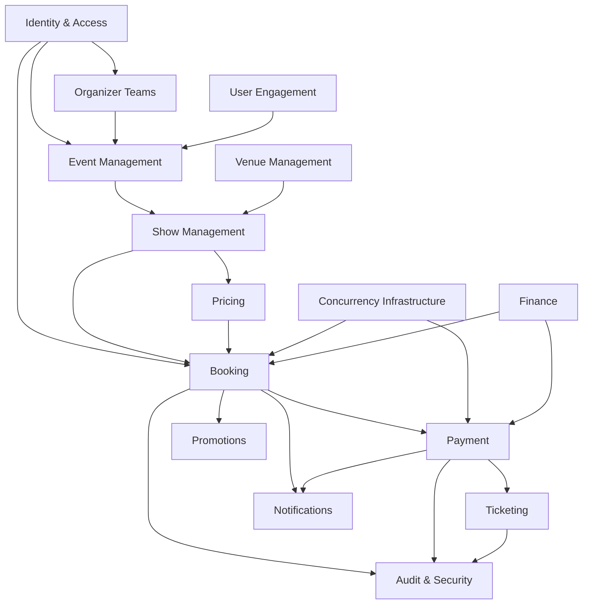
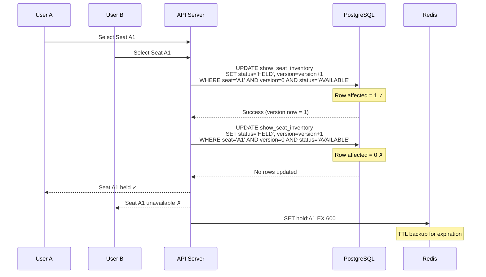
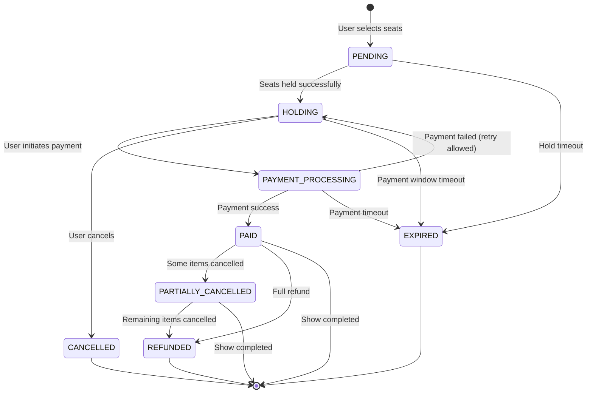
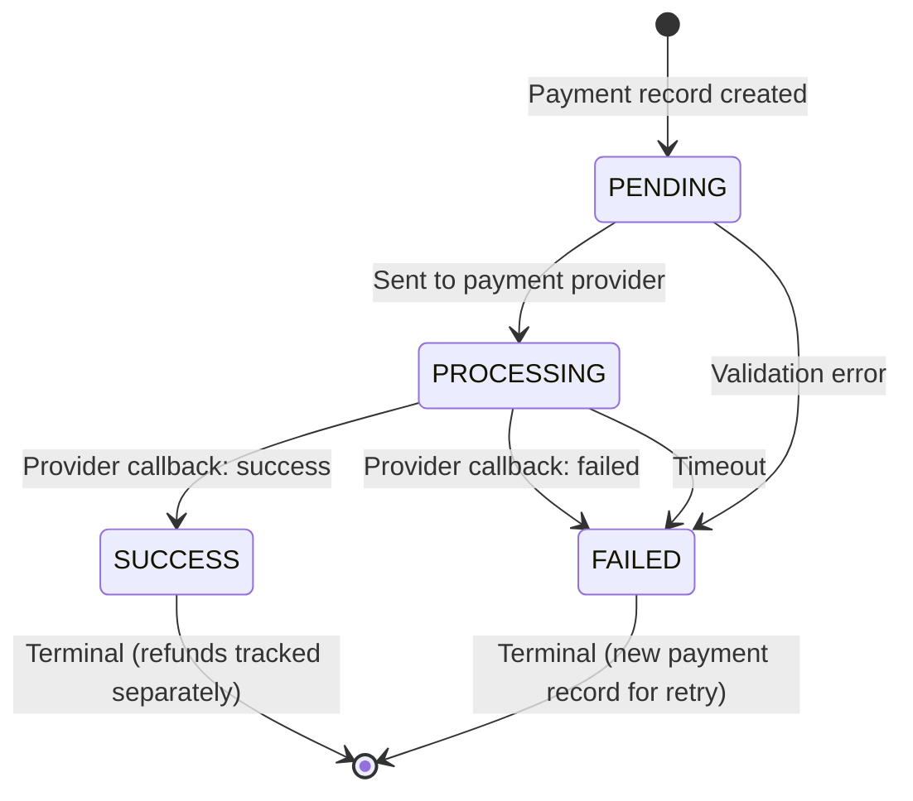
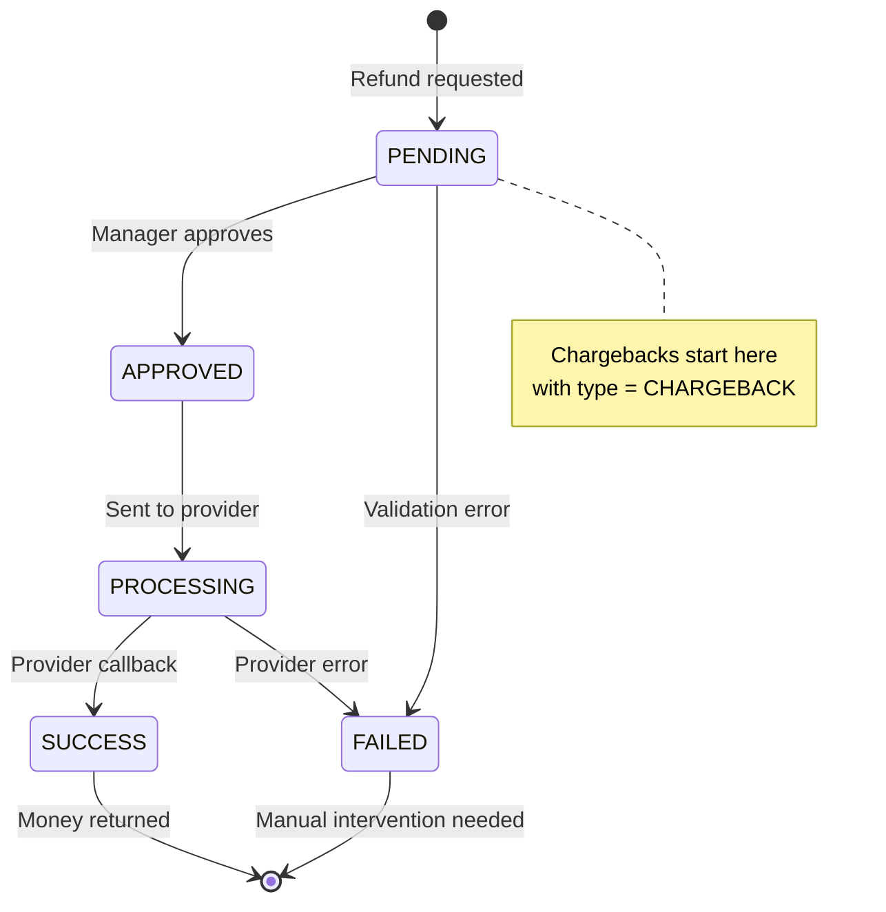
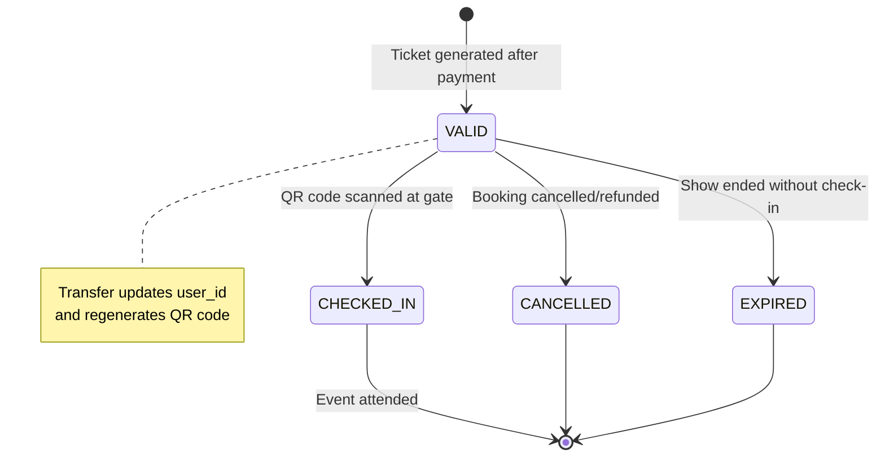

# Ticket Booking System — Production-Ready PostgreSQL Database Design

> A complete database architecture for a commercial-grade ticket booking platform, designed for high concurrency, scalability, and maintainability.
> 
> **Version**: 2.0 (Post Architecture Review)  
> **Total Tables**: 44  
> **Original Tables**: 22 (6 modified)  
> **New Tables**: 22 (from architecture review)

---

## Table of Contents

1. [High-Level Domain Modules](#1-high-level-domain-modules)
2. [Complete ER Diagram](#2-complete-er-diagram)
3. [Table-by-Table Explanation](#3-table-by-table-explanation)
   - Module 1: Identity & Access
   - Module 2: Event Management
   - Module 3: Venue Management
   - Module 4: Show Management
   - Module 5: Booking
   - Module 6: Payment
   - Module 7: Ticketing
   - Module 8: Promotions
   - Module 9: Notifications
   - Module 10: Audit & Security
   - Module 11: Pricing
   - Module 12: Organizer Teams
   - Module 13: Concurrency Infrastructure
   - Module 14: User Engagement
   - Module 15: Finance
4. [Relationship Summary](#4-relationship-summary)
5. [Suggested Indexes — Complete Summary](#5-suggested-indexes--complete-summary)
6. [Concurrency-Related Tables & Mechanisms](#6-concurrency-related-tables--mechanisms)
7. [Booking Lifecycle](#7-booking-lifecycle)
8. [Payment Lifecycle](#8-payment-lifecycle)
9. [Ticket Lifecycle](#9-ticket-lifecycle)
10. [Potential Future Extensions](#10-potential-future-extensions)
11. [Senior Architecture Review — Recommendations](#11-senior-architecture-review--recommendations)

---

## 1. High-Level Domain Modules

The system is decomposed into **15 bounded contexts** (domain modules), each owning its own set of tables:

| # | Module | Responsibility | Core Tables |
|---|--------|---------------|-------------|
| 1 | **Identity & Access** | Authentication, authorization, RBAC | `users`, `roles`, `permissions`, `role_permissions`, `user_roles`, `verification_tokens` |
| 2 | **Event Management** | Events, categories, organizers, images | `events`, `event_categories`, `organizers`, `event_images` |
| 3 | **Venue Management** | Venues, halls, seat layouts | `venues`, `halls`, `seats` |
| 4 | **Show Management** | Scheduling shows for events in halls | `shows`, `show_seat_inventory` |
| 5 | **Booking** | Seat selection, holding, booking lifecycle | `bookings`, `booking_items`, `booking_status_history`, `waitlist_entries` |
| 6 | **Payment** | Payment processing, refunds, webhooks | `payments`, `payment_providers`, `refunds`, `webhook_events`, `settlement_records` |
| 7 | **Ticketing** | Ticket generation, QR codes, check-in, transfer | `tickets`, `ticket_transfers`, `ticket_scan_logs` |
| 8 | **Promotions** | Coupons, campaigns, discounts | `coupons`, `coupon_usages`, `promotion_campaigns` |
| 9 | **Notifications** | User notifications, delivery tracking, templates | `notifications`, `notification_templates`, `notification_preferences` |
| 10 | **Audit & Security** | Action logging, admin accountability, fraud | `audit_logs`, `admin_action_logs`, `fraud_signals` |
| 11 | **Pricing** | Dynamic pricing, tiers, rules | `pricing_tiers`, `pricing_rules` |
| 12 | **Organizer Teams** | Multi-user organizer management | `organizer_members`, `organizer_invitations` |
| 13 | **Concurrency Infrastructure** | Idempotency, distributed locks | `idempotency_keys`, `distributed_locks` |
| 14 | **User Engagement** | Favorites, reviews | `event_favorites`, `event_reviews` |
| 15 | **Finance** | User wallets, transactions | `wallets`, `wallet_transactions` |

### Module Dependency Graph



---

## 2. Complete ER Diagram

```mermaid
erDiagram
    %% ===== IDENTITY & ACCESS =====
    users {
        uuid id PK
        varchar email UK
        varchar password_hash
        varchar full_name
        varchar phone
        varchar avatar_url
        boolean is_email_verified
        smallint failed_login_attempts
        timestamp locked_until
        timestamp last_login_at
        int version
        timestamp created_at
        timestamp updated_at
        timestamp deleted_at
    }

    roles {
        uuid id PK
        varchar name UK
        varchar description
        timestamp created_at
        timestamp updated_at
    }

    permissions {
        uuid id PK
        varchar code UK
        varchar description
        varchar module
        timestamp created_at
    }

    user_roles {
        uuid id PK
        uuid user_id FK
        uuid role_id FK
        timestamp created_at
    }

    role_permissions {
        uuid id PK
        uuid role_id FK
        uuid permission_id FK
        timestamp created_at
    }

    verification_tokens {
        uuid id PK
        uuid user_id FK
        varchar token_hash
        varchar type
        boolean is_used
        timestamp expires_at
        timestamp used_at
        timestamp created_at
    }

    %% ===== EVENT MANAGEMENT =====
    organizers {
        uuid id PK
        uuid user_id FK
        varchar name
        text description
        varchar logo_url
        varchar website
        varchar phone
        varchar email
        boolean is_verified
        int version
        timestamp created_at
        timestamp updated_at
        timestamp deleted_at
    }

    event_categories {
        uuid id PK
        varchar name UK
        varchar slug UK
        varchar description
        varchar icon_url
        int display_order
        boolean is_active
        timestamp created_at
        timestamp updated_at
    }

    events {
        uuid id PK
        uuid organizer_id FK
        uuid category_id FK
        varchar title
        text description
        varchar slug UK
        varchar event_status
        smallint min_age
        timestamp start_date
        timestamp end_date
        varchar thumbnail_url
        boolean is_featured
        int version
        timestamp created_at
        timestamp updated_at
        timestamp deleted_at
    }

    event_images {
        uuid id PK
        uuid event_id FK
        varchar image_url
        varchar alt_text
        int display_order
        boolean is_primary
        timestamp created_at
    }

    %% ===== VENUE MANAGEMENT =====
    venues {
        uuid id PK
        varchar name
        text address
        varchar city
        varchar state
        varchar country
        varchar zip_code
        decimal latitude
        decimal longitude
        varchar phone
        varchar email
        text description
        int total_capacity
        boolean is_active
        int version
        timestamp created_at
        timestamp updated_at
        timestamp deleted_at
    }

    halls {
        uuid id PK
        uuid venue_id FK
        varchar name
        int capacity
        int total_rows
        int total_columns
        jsonb layout_config
        boolean is_active
        int version
        timestamp created_at
        timestamp updated_at
    }

    seats {
        uuid id PK
        uuid hall_id FK
        varchar row_label
        int seat_number
        varchar seat_type
        int x_position
        int y_position
        boolean is_active
        timestamp created_at
        timestamp updated_at
    }

    %% ===== SHOW MANAGEMENT =====
    shows {
        uuid id PK
        uuid event_id FK
        uuid hall_id FK
        timestamp start_time
        timestamp end_time
        timestamp booking_open_at
        timestamp booking_close_at
        varchar status
        int total_seats
        int available_seats
        int version
        timestamp created_at
        timestamp updated_at
        timestamp deleted_at
    }

    show_seat_inventory {
        uuid id PK
        uuid show_id FK
        uuid seat_id FK
        uuid pricing_tier_id FK
        varchar status
        decimal base_price
        uuid held_by_user_id FK
        timestamp held_until
        uuid booking_id FK
        int version
        timestamp created_at
        timestamp updated_at
    }

    %% ===== PRICING =====
    pricing_tiers {
        uuid id PK
        uuid show_id FK
        varchar name
        decimal base_price
        varchar color_code
        int display_order
        timestamp created_at
        timestamp updated_at
    }

    pricing_rules {
        uuid id PK
        uuid show_id FK
        uuid pricing_tier_id FK
        varchar name
        varchar rule_type
        varchar adjustment_type
        decimal adjustment_value
        decimal max_adjustment
        jsonb conditions
        int priority
        boolean is_active
        timestamp valid_from
        timestamp valid_until
        timestamp created_at
        timestamp updated_at
    }

    %% ===== BOOKING =====
    bookings {
        uuid id PK
        varchar booking_number UK
        uuid user_id FK
        uuid show_id FK
        uuid coupon_id FK
        varchar status
        int item_count
        decimal subtotal
        decimal discount_amount
        decimal total_amount
        timestamp expires_at
        varchar cancellation_reason
        text notes
        varchar idempotency_key UK
        int version
        timestamp created_at
        timestamp updated_at
    }

    booking_items {
        uuid id PK
        uuid booking_id FK
        uuid show_seat_inventory_id FK
        decimal price
        varchar status
        timestamp cancelled_at
        varchar cancellation_reason
        timestamp created_at
    }

    booking_status_history {
        uuid id PK
        uuid booking_id FK
        varchar from_status
        varchar to_status
        varchar trigger
        uuid triggered_by FK
        jsonb metadata
        timestamp created_at
    }

    waitlist_entries {
        uuid id PK
        uuid show_id FK
        uuid user_id FK
        int requested_seat_count
        varchar preferred_seat_type
        decimal max_price_per_seat
        int priority
        varchar status
        timestamp notified_at
        timestamp offer_expires_at
        uuid converted_booking_id FK
        timestamp created_at
        timestamp updated_at
    }

    %% ===== PAYMENT =====
    payment_providers {
        uuid id PK
        varchar name UK
        varchar code UK
        varchar description
        boolean is_active
        jsonb config
        timestamp created_at
        timestamp updated_at
    }

    payments {
        uuid id PK
        varchar transaction_id UK
        uuid booking_id FK
        uuid provider_id FK
        uuid user_id FK
        decimal amount
        varchar currency
        varchar status
        varchar provider_transaction_id
        jsonb provider_response
        varchar failure_reason
        timestamp paid_at
        timestamp refunded_at
        int version
        timestamp created_at
        timestamp updated_at
    }

    refunds {
        uuid id PK
        varchar refund_number UK
        uuid payment_id FK
        uuid booking_id FK
        uuid user_id FK
        varchar type
        decimal amount
        varchar currency
        varchar reason
        varchar status
        uuid approved_by FK
        timestamp approved_at
        varchar provider_refund_id
        jsonb provider_response
        timestamp processed_at
        varchar failure_reason
        int version
        timestamp created_at
        timestamp updated_at
    }

    webhook_events {
        uuid id PK
        uuid provider_id FK
        varchar event_id UK
        varchar event_type
        jsonb payload
        varchar status
        timestamp processed_at
        varchar error_message
        int retry_count
        timestamp created_at
    }

    settlement_records {
        uuid id PK
        uuid provider_id FK
        varchar settlement_reference
        uuid organizer_id FK
        decimal total_amount
        decimal fee_amount
        decimal net_amount
        varchar currency
        varchar status
        timestamp period_start
        timestamp period_end
        timestamp settled_at
        timestamp created_at
    }

    %% ===== TICKETING =====
    tickets {
        uuid id PK
        varchar ticket_number UK
        uuid booking_id FK
        uuid booking_item_id FK
        uuid user_id FK
        uuid show_id FK
        varchar qr_code UK
        int qr_code_version
        timestamp qr_regenerated_at
        varchar status
        timestamp checked_in_at
        uuid checked_in_by FK
        varchar gate
        int version
        timestamp created_at
        timestamp updated_at
    }

    ticket_transfers {
        uuid id PK
        uuid ticket_id FK
        uuid from_user_id FK
        uuid to_user_id FK
        varchar transfer_type
        varchar status
        decimal transfer_fee
        varchar message
        timestamp accepted_at
        timestamp expired_at
        timestamp created_at
    }

    ticket_scan_logs {
        uuid id PK
        uuid ticket_id FK
        uuid show_id FK
        uuid scanned_by FK
        varchar gate
        varchar scan_result
        varchar device_id
        boolean scanned_offline
        timestamp synced_at
        varchar failure_reason
        timestamp created_at
    }

    %% ===== PROMOTIONS =====
    promotion_campaigns {
        uuid id PK
        varchar name
        text description
        varchar campaign_type
        decimal budget
        decimal spent_amount
        boolean is_active
        timestamp start_date
        timestamp end_date
        uuid created_by FK
        timestamp created_at
        timestamp updated_at
    }

    coupons {
        uuid id PK
        varchar code UK
        uuid campaign_id FK
        varchar discount_type
        decimal discount_value
        decimal max_discount
        decimal min_order_amount
        int max_usage
        int max_usage_per_user
        int used_count
        uuid event_id FK
        uuid user_id FK
        boolean is_active
        timestamp valid_from
        timestamp valid_until
        int version
        timestamp created_at
        timestamp updated_at
        timestamp deleted_at
    }

    coupon_usages {
        uuid id PK
        uuid coupon_id FK
        uuid user_id FK
        uuid booking_id FK
        decimal discount_applied
        timestamp created_at
    }

    %% ===== NOTIFICATIONS =====
    notification_templates {
        uuid id PK
        varchar code
        varchar channel
        varchar language
        varchar subject
        text body_template
        jsonb variables
        boolean is_active
        int version
        timestamp created_at
        timestamp updated_at
    }

    notification_preferences {
        uuid id PK
        uuid user_id FK
        varchar notification_type
        varchar channel
        boolean is_enabled
        timestamp updated_at
        timestamp created_at
    }

    notifications {
        uuid id PK
        uuid user_id FK
        uuid template_id FK
        varchar type
        varchar channel
        varchar title
        text content
        jsonb metadata
        varchar delivery_status
        timestamp read_at
        timestamp sent_at
        int retry_count
        varchar failure_reason
        timestamp created_at
    }

    %% ===== AUDIT & SECURITY =====
    audit_logs {
        uuid id PK
        uuid user_id FK
        varchar action
        varchar entity_type
        uuid entity_id
        jsonb old_values
        jsonb new_values
        varchar ip_address
        varchar user_agent
        varchar correlation_id
        varchar trace_id
        varchar span_id
        varchar service_name
        timestamp created_at
    }

    admin_action_logs {
        uuid id PK
        uuid admin_user_id FK
        varchar action
        varchar target_entity_type
        uuid target_entity_id
        text reason
        jsonb details
        boolean requires_approval
        uuid approved_by FK
        timestamp approved_at
        varchar ip_address
        timestamp created_at
    }

    fraud_signals {
        uuid id PK
        uuid user_id FK
        varchar signal_type
        varchar severity
        varchar entity_type
        uuid entity_id
        jsonb details
        varchar status
        uuid resolved_by FK
        varchar resolution
        timestamp created_at
        timestamp updated_at
    }

    %% ===== ORGANIZER TEAMS =====
    organizer_members {
        uuid id PK
        uuid organizer_id FK
        uuid user_id FK
        varchar role
        uuid invited_by FK
        varchar status
        timestamp accepted_at
        timestamp created_at
        timestamp updated_at
    }

    organizer_invitations {
        uuid id PK
        uuid organizer_id FK
        varchar invited_email
        uuid invited_user_id FK
        varchar role
        uuid invited_by FK
        varchar token UK
        varchar status
        timestamp expires_at
        timestamp accepted_at
        timestamp created_at
    }

    %% ===== CONCURRENCY INFRASTRUCTURE =====
    idempotency_keys {
        uuid id PK
        varchar idempotency_key UK
        varchar operation
        uuid user_id FK
        varchar request_hash
        int response_code
        jsonb response_body
        timestamp created_at
        timestamp expires_at
    }

    distributed_locks {
        uuid id PK
        varchar lock_key
        varchar lock_type
        uuid owner_id FK
        uuid resource_id
        timestamp acquired_at
        timestamp expires_at
        timestamp released_at
        timestamp created_at
    }

    %% ===== USER ENGAGEMENT =====
    event_favorites {
        uuid id PK
        uuid user_id FK
        uuid event_id FK
        timestamp created_at
    }

    event_reviews {
        uuid id PK
        uuid event_id FK
        uuid user_id FK
        uuid booking_id FK
        smallint rating
        varchar title
        text comment
        boolean is_verified_purchase
        boolean is_visible
        int helpful_count
        timestamp created_at
        timestamp updated_at
        timestamp deleted_at
    }

    %% ===== FINANCE =====
    wallets {
        uuid id PK
        uuid user_id FK
        decimal balance
        varchar currency
        boolean is_active
        int version
        timestamp created_at
        timestamp updated_at
    }

    wallet_transactions {
        uuid id PK
        uuid wallet_id FK
        varchar type
        decimal amount
        decimal balance_before
        decimal balance_after
        varchar reference_type
        uuid reference_id
        varchar description
        timestamp created_at
    }

    %% ===== RELATIONSHIPS =====
    users ||--o{ user_roles : "has"
    roles ||--o{ user_roles : "assigned_to"
    roles ||--o{ role_permissions : "has"
    permissions ||--o{ role_permissions : "granted_in"
    users ||--o{ verification_tokens : "verifies_with"

    users ||--o{ organizers : "manages"
    organizers ||--o{ events : "creates"
    organizers ||--o{ organizer_members : "has_team"
    organizers ||--o{ organizer_invitations : "invites"
    event_categories ||--o{ events : "categorizes"
    events ||--o{ event_images : "has"
    events ||--o{ shows : "schedules"

    venues ||--o{ halls : "contains"
    halls ||--o{ seats : "contains"
    halls ||--o{ shows : "hosts"

    shows ||--o{ show_seat_inventory : "tracks"
    shows ||--o{ pricing_tiers : "priced_by"
    shows ||--o{ pricing_rules : "rules_for"
    seats ||--o{ show_seat_inventory : "referenced_in"
    pricing_tiers ||--o{ show_seat_inventory : "categorizes"

    users ||--o{ bookings : "makes"
    shows ||--o{ bookings : "booked_for"
    bookings ||--o{ booking_items : "contains"
    bookings ||--o{ booking_status_history : "tracks"
    show_seat_inventory ||--o{ booking_items : "allocated_in"
    shows ||--o{ waitlist_entries : "waitlisted"

    bookings ||--o{ payments : "paid_by"
    payment_providers ||--o{ payments : "processes"
    payments ||--o{ refunds : "refunded_by"
    bookings ||--o{ refunds : "refunded_for"
    payment_providers ||--o{ webhook_events : "receives"

    bookings ||--o{ tickets : "generates"
    booking_items ||--o{ tickets : "issues"
    tickets ||--o{ ticket_transfers : "transferred"
    tickets ||--o{ ticket_scan_logs : "scanned"

    promotion_campaigns ||--o{ coupons : "groups"
    coupons ||--o{ coupon_usages : "tracked_in"
    coupons ||--o{ bookings : "applied_to"

    notification_templates ||--o{ notifications : "renders"
    users ||--o{ notifications : "receives"
    users ||--o{ notification_preferences : "configures"

    users ||--o{ audit_logs : "performed"
    users ||--o{ fraud_signals : "flagged"

    users ||--o{ event_favorites : "favorites"
    events ||--o{ event_favorites : "favorited_by"
    users ||--o{ event_reviews : "reviews"
    events ||--o{ event_reviews : "reviewed_by"

    users ||--o{ wallets : "owns"
    wallets ||--o{ wallet_transactions : "records"
```

---

## 3. Table-by-Table Explanation

---

### Module 1: Identity & Access

---

#### Table: `users`

**Purpose**: Central identity store for all platform users — customers, organizers, and admins. Serves as the authentication entity and the root reference for all user-related operations.

| Column | Type | Nullable | Default | Description |
|--------|------|----------|---------|-------------|
| `id` | `UUID` | NO | `gen_random_uuid()` | Primary key |
| `email` | `VARCHAR(255)` | NO | — | Unique login identifier |
| `password_hash` | `VARCHAR(255)` | NO | — | Bcrypt/Argon2 hashed password |
| `full_name` | `VARCHAR(150)` | NO | — | Display name |
| `phone` | `VARCHAR(20)` | YES | `NULL` | Optional phone number |
| `avatar_url` | `VARCHAR(500)` | YES | `NULL` | Profile picture URL |
| `is_email_verified` | `BOOLEAN` | NO | `FALSE` | Email verification flag |
| `failed_login_attempts` | `SMALLINT` | NO | `0` | Brute-force protection counter |
| `locked_until` | `TIMESTAMPTZ` | YES | `NULL` | Account lock expiry |
| `last_login_at` | `TIMESTAMPTZ` | YES | `NULL` | Last successful login |
| `version` | `INT` | NO | `0` | Optimistic locking version |
| `created_at` | `TIMESTAMPTZ` | NO | `NOW()` | Record creation time |
| `updated_at` | `TIMESTAMPTZ` | NO | `NOW()` | Last modification time |
| `deleted_at` | `TIMESTAMPTZ` | YES | `NULL` | Soft delete marker |

**Primary Key**: `id`

**Foreign Keys**: None

**Unique Constraints**:
- `uk_users_email` ON `(email)` WHERE `deleted_at IS NULL` — partial unique index to allow re-registration after soft delete

**Check Constraints**:
- `ck_users_email_format`: `email ~* '^[A-Za-z0-9._%+-]+@[A-Za-z0-9.-]+\.[A-Za-z]{2,}$'`
- `ck_users_failed_login`: `failed_login_attempts >= 0`

**Recommended Indexes**:
| Index | Columns | Type | Reason |
|-------|---------|------|--------|
| `idx_users_email` | `email` | B-Tree (partial, `deleted_at IS NULL`) | Login lookup — the most frequent query |
| `idx_users_deleted_at` | `deleted_at` | B-Tree (partial, `deleted_at IS NOT NULL`) | Soft-delete filtering |
| `idx_users_phone` | `phone` | B-Tree | Phone-based lookup |

**Relationships**:
- One-to-Many → `user_roles`, `organizers`, `bookings`, `payments`, `notifications`, `audit_logs`, `verification_tokens`, `wallets`, `event_favorites`, `event_reviews`, `notification_preferences`

**Business Rules**:
1. Email must be unique among active (non-deleted) users
2. Account locks after N failed login attempts (application-level policy using `failed_login_attempts` and `locked_until`)
3. Users cannot log in until email is verified (`is_email_verified = TRUE`)
4. Soft delete preserves booking and payment history

**Design Decisions**:
- **UUID over BIGSERIAL**: UUIDs allow distributed ID generation without coordination, critical for horizontal scaling and microservice decomposition. Trade-off: slightly larger index size (~16 bytes vs 8 bytes) and less cache-friendly sequential scans.
- **`password_hash` in users table**: For a monolith/modular monolith this is acceptable. In a true microservice split, authentication would move to a separate service with its own credential store.
- **Partial unique index on email**: Allows the same email to appear in soft-deleted rows while preventing duplicates among active users.
- **Optimistic locking (`version`)**: Prevents lost updates during concurrent profile edits without database-level row locks.

---

#### Table: `roles`

**Purpose**: Defines named authorization roles (e.g., `CUSTOMER`, `ORGANIZER`, `ADMIN`, `SUPER_ADMIN`). Exists as a reference table for RBAC.

| Column | Type | Nullable | Default | Description |
|--------|------|----------|---------|-------------|
| `id` | `UUID` | NO | `gen_random_uuid()` | Primary key |
| `name` | `VARCHAR(50)` | NO | — | Role name (e.g., `ADMIN`) |
| `description` | `VARCHAR(255)` | YES | `NULL` | Human-readable description |
| `created_at` | `TIMESTAMPTZ` | NO | `NOW()` | Record creation |
| `updated_at` | `TIMESTAMPTZ` | NO | `NOW()` | Last update |

**Primary Key**: `id`

**Unique Constraints**: `uk_roles_name` ON `(name)`

**Recommended Indexes**: The unique constraint creates an implicit index. No additional indexes needed — this is a low-cardinality reference table.

**Relationships**:
- One-to-Many → `user_roles`
- One-to-Many → `role_permissions`

**Business Rules**:
1. Role names are immutable identifiers (application-level)
2. Predefined seed roles: `CUSTOMER`, `ORGANIZER`, `ADMIN`, `SUPER_ADMIN`

**Design Decisions**:
- **Table over PostgreSQL ENUM**: Roles may evolve (new roles added, descriptions updated). A table allows runtime changes without DDL migrations. Trade-off: an extra JOIN vs inline enum comparison.

---

#### Table: `permissions`

**Purpose**: Fine-grained permission codes (e.g., `EVENT_CREATE`, `BOOKING_CANCEL`, `USER_MANAGE`). Enables granular access control beyond role-level.

| Column | Type | Nullable | Default | Description |
|--------|------|----------|---------|-------------|
| `id` | `UUID` | NO | `gen_random_uuid()` | Primary key |
| `code` | `VARCHAR(100)` | NO | — | Machine-readable permission code |
| `description` | `VARCHAR(255)` | YES | `NULL` | Human-readable description |
| `module` | `VARCHAR(50)` | NO | — | Domain module this permission belongs to |
| `created_at` | `TIMESTAMPTZ` | NO | `NOW()` | Record creation |

**Primary Key**: `id`

**Unique Constraints**: `uk_permissions_code` ON `(code)`

**Recommended Indexes**:
| Index | Columns | Reason |
|-------|---------|--------|
| `idx_permissions_module` | `module` | Filter permissions by module in admin UI |

**Relationships**:
- One-to-Many → `role_permissions`

---

#### Table: `user_roles`

**Purpose**: Many-to-Many junction table linking users to their assigned roles.

| Column | Type | Nullable | Default | Description |
|--------|------|----------|---------|-------------|
| `id` | `UUID` | NO | `gen_random_uuid()` | Primary key |
| `user_id` | `UUID` | NO | — | FK → `users.id` |
| `role_id` | `UUID` | NO | — | FK → `roles.id` |
| `created_at` | `TIMESTAMPTZ` | NO | `NOW()` | Assignment time |

**Primary Key**: `id`

**Foreign Keys**:
- `fk_user_roles_user` → `users(id)` ON DELETE CASCADE
- `fk_user_roles_role` → `roles(id)` ON DELETE RESTRICT

**Unique Constraints**: `uk_user_roles` ON `(user_id, role_id)`

**Recommended Indexes**:
| Index | Columns | Reason |
|-------|---------|--------|
| `idx_user_roles_user_id` | `user_id` | Fetch all roles for a user (authorization check) |
| `idx_user_roles_role_id` | `role_id` | Fetch all users in a role (admin management) |

---

#### Table: `role_permissions`

**Purpose**: Many-to-Many junction linking roles to their granted permissions.

| Column | Type | Nullable | Default | Description |
|--------|------|----------|---------|-------------|
| `id` | `UUID` | NO | `gen_random_uuid()` | Primary key |
| `role_id` | `UUID` | NO | — | FK → `roles.id` |
| `permission_id` | `UUID` | NO | — | FK → `permissions.id` |
| `created_at` | `TIMESTAMPTZ` | NO | `NOW()` | Assignment time |

**Primary Key**: `id`

**Foreign Keys**:
- `fk_role_permissions_role` → `roles(id)` ON DELETE CASCADE
- `fk_role_permissions_permission` → `permissions(id)` ON DELETE RESTRICT

**Unique Constraints**: `uk_role_permissions` ON `(role_id, permission_id)`

**Recommended Indexes**:
| Index | Columns | Reason |
|-------|---------|--------|
| `idx_role_permissions_role_id` | `role_id` | Fetch all permissions for a role |

---

#### Table: `verification_tokens` *(NEW)*

**Purpose**: Stores time-limited tokens for email verification, password reset, phone verification, and 2FA. Ensures all authentication flows use secure, expirable, single-use tokens.

| Column | Type | Nullable | Default | Description |
|--------|------|----------|---------|-------------|
| `id` | `UUID` | NO | `gen_random_uuid()` | Primary key |
| `user_id` | `UUID` | NO | — | FK → `users.id` |
| `token_hash` | `VARCHAR(255)` | NO | — | SHA256 hash of token (never store raw) |
| `type` | `VARCHAR(30)` | NO | — | Token purpose |
| `is_used` | `BOOLEAN` | NO | `FALSE` | Whether token has been consumed |
| `expires_at` | `TIMESTAMPTZ` | NO | — | Token expiry |
| `used_at` | `TIMESTAMPTZ` | YES | `NULL` | When token was used |
| `created_at` | `TIMESTAMPTZ` | NO | `NOW()` | Record creation |

**Primary Key**: `id`

**Foreign Keys**: `fk_vt_user` → `users(id)` ON DELETE CASCADE

**Check Constraints**:
- `ck_vt_type`: `type IN ('EMAIL_VERIFICATION', 'PASSWORD_RESET', 'PHONE_VERIFICATION', 'TWO_FACTOR')`

**Recommended Indexes**:
| Index | Columns | Reason |
|-------|---------|--------|
| `idx_vt_token_hash` | `token_hash` | Token lookup during verification |
| `idx_vt_user_type` | `(user_id, type)` | User's tokens by type |
| `idx_vt_expires_at` | `expires_at` WHERE `is_used = FALSE` | Cleanup expired tokens |

**Business Rules**:
1. Tokens are single-use — once consumed, `is_used = TRUE`
2. Expired tokens are ignored during validation
3. Old unused tokens are cleaned up by a scheduled job

---

### Module 2: Event Management

---

#### Table: `organizers`

**Purpose**: Represents event organizers — companies or individuals who create and manage events. Decoupled from `users` to allow one user to manage multiple organizer brands.

| Column | Type | Nullable | Default | Description |
|--------|------|----------|---------|-------------|
| `id` | `UUID` | NO | `gen_random_uuid()` | Primary key |
| `user_id` | `UUID` | NO | — | FK → `users.id` — the primary owner |
| `name` | `VARCHAR(200)` | NO | — | Organizer brand name |
| `description` | `TEXT` | YES | `NULL` | About the organizer |
| `logo_url` | `VARCHAR(500)` | YES | `NULL` | Brand logo |
| `website` | `VARCHAR(500)` | YES | `NULL` | Official website |
| `phone` | `VARCHAR(20)` | YES | `NULL` | Contact phone |
| `email` | `VARCHAR(255)` | YES | `NULL` | Contact email |
| `is_verified` | `BOOLEAN` | NO | `FALSE` | Admin-verified organizer |
| `version` | `INT` | NO | `0` | Optimistic locking |
| `created_at` | `TIMESTAMPTZ` | NO | `NOW()` | Record creation |
| `updated_at` | `TIMESTAMPTZ` | NO | `NOW()` | Last update |
| `deleted_at` | `TIMESTAMPTZ` | YES | `NULL` | Soft delete |

**Primary Key**: `id`

**Foreign Keys**: `fk_organizers_user` → `users(id)` ON DELETE RESTRICT

**Recommended Indexes**:
| Index | Columns | Reason |
|-------|---------|--------|
| `idx_organizers_user_id` | `user_id` | Fetch organizers managed by a user |
| `idx_organizers_is_verified` | `is_verified` | Filter verified organizers |

**Relationships**:
- Many-to-One → `users`
- One-to-Many → `events`, `organizer_members`, `organizer_invitations`, `settlement_records`

**Business Rules**:
1. Only verified organizers can publish events (application-level)
2. `user_id` represents the primary owner; team members are managed via `organizer_members`

**Design Decisions**:
- **`user_id` kept for backward compatibility**: The `organizer_members` table (Module 12) provides team-based access. `user_id` remains as the "primary owner" shortcut. New code should check `organizer_members` for authorization.

---

#### Table: `event_categories`

**Purpose**: Classifies events (e.g., Concert, Sports, Theater, Conference). Used for browsing and filtering.

| Column | Type | Nullable | Default | Description |
|--------|------|----------|---------|-------------|
| `id` | `UUID` | NO | `gen_random_uuid()` | Primary key |
| `name` | `VARCHAR(100)` | NO | — | Category name |
| `slug` | `VARCHAR(100)` | NO | — | URL-friendly identifier |
| `description` | `VARCHAR(500)` | YES | `NULL` | Category description |
| `icon_url` | `VARCHAR(500)` | YES | `NULL` | Category icon |
| `display_order` | `INT` | NO | `0` | UI sort order |
| `is_active` | `BOOLEAN` | NO | `TRUE` | Show/hide in UI |
| `created_at` | `TIMESTAMPTZ` | NO | `NOW()` | Record creation |
| `updated_at` | `TIMESTAMPTZ` | NO | `NOW()` | Last update |

**Primary Key**: `id`

**Unique Constraints**:
- `uk_event_categories_name` ON `(name)`
- `uk_event_categories_slug` ON `(slug)`

---

#### Table: `events`

**Purpose**: The core business entity — an event that users can book tickets for. Events are owned by organizers and categorized.

| Column | Type | Nullable | Default | Description |
|--------|------|----------|---------|-------------|
| `id` | `UUID` | NO | `gen_random_uuid()` | Primary key |
| `organizer_id` | `UUID` | NO | — | FK → `organizers.id` |
| `category_id` | `UUID` | NO | — | FK → `event_categories.id` |
| `title` | `VARCHAR(300)` | NO | — | Event title |
| `description` | `TEXT` | YES | `NULL` | Rich text event description |
| `slug` | `VARCHAR(350)` | NO | — | URL slug |
| `event_status` | `VARCHAR(20)` | NO | `'DRAFT'` | Current status |
| `min_age` | `SMALLINT` | YES | `NULL` | Minimum age restriction (NULL = no restriction) |
| `start_date` | `TIMESTAMPTZ` | NO | — | Event start date |
| `end_date` | `TIMESTAMPTZ` | NO | — | Event end date |
| `thumbnail_url` | `VARCHAR(500)` | YES | `NULL` | Main thumbnail |
| `is_featured` | `BOOLEAN` | NO | `FALSE` | Featured on homepage |
| `version` | `INT` | NO | `0` | Optimistic locking |
| `created_at` | `TIMESTAMPTZ` | NO | `NOW()` | Record creation |
| `updated_at` | `TIMESTAMPTZ` | NO | `NOW()` | Last update |
| `deleted_at` | `TIMESTAMPTZ` | YES | `NULL` | Soft delete |

**Primary Key**: `id`

**Foreign Keys**:
- `fk_events_organizer` → `organizers(id)` ON DELETE RESTRICT
- `fk_events_category` → `event_categories(id)` ON DELETE RESTRICT

**Unique Constraints**: `uk_events_slug` ON `(slug)` WHERE `deleted_at IS NULL`

**Check Constraints**:
- `ck_events_status`: `event_status IN ('DRAFT', 'PUBLISHED', 'CANCELLED', 'COMPLETED', 'SUSPENDED')`
- `ck_events_dates`: `end_date > start_date`
- `ck_events_min_age`: `min_age IS NULL OR (min_age >= 0 AND min_age <= 21)`

**Recommended Indexes**:
| Index | Columns | Reason |
|-------|---------|--------|
| `idx_events_organizer_id` | `organizer_id` | Fetch events by organizer |
| `idx_events_category_id` | `category_id` | Browse events by category |
| `idx_events_status` | `event_status` WHERE `deleted_at IS NULL` | Filter active events by status |
| `idx_events_start_date` | `start_date` WHERE `deleted_at IS NULL` | Chronological browsing |
| `idx_events_featured` | `is_featured` WHERE `is_featured = TRUE AND deleted_at IS NULL` | Homepage featured events |

**Business Rules**:
1. Events start in `DRAFT` status; only `PUBLISHED` events show to customers
2. An event cannot be deleted if it has active (non-cancelled) bookings
3. `end_date` must be after `start_date` (database-enforced)
4. No venue FK on events — venue association lives on `shows` (touring events)

---

#### Table: `event_images`

**Purpose**: Gallery images for an event. Supports multiple images with ordering.

| Column | Type | Nullable | Default | Description |
|--------|------|----------|---------|-------------|
| `id` | `UUID` | NO | `gen_random_uuid()` | Primary key |
| `event_id` | `UUID` | NO | — | FK → `events.id` |
| `image_url` | `VARCHAR(500)` | NO | — | Image URL (CDN path) |
| `alt_text` | `VARCHAR(255)` | YES | `NULL` | Accessibility alt text |
| `display_order` | `INT` | NO | `0` | Image display order |
| `is_primary` | `BOOLEAN` | NO | `FALSE` | Primary gallery image |
| `created_at` | `TIMESTAMPTZ` | NO | `NOW()` | Record creation |

**Primary Key**: `id`

**Foreign Keys**: `fk_event_images_event` → `events(id)` ON DELETE CASCADE

**Recommended Indexes**:
| Index | Columns | Reason |
|-------|---------|--------|
| `idx_event_images_event_id` | `event_id` | Fetch all images for an event |

---

### Module 3: Venue Management

---

#### Table: `venues`

**Purpose**: Physical locations where events take place. A venue contains multiple halls.

| Column | Type | Nullable | Default | Description |
|--------|------|----------|---------|-------------|
| `id` | `UUID` | NO | `gen_random_uuid()` | Primary key |
| `name` | `VARCHAR(200)` | NO | — | Venue name |
| `address` | `TEXT` | NO | — | Full street address |
| `city` | `VARCHAR(100)` | NO | — | City |
| `state` | `VARCHAR(100)` | YES | `NULL` | State/Province |
| `country` | `VARCHAR(100)` | NO | — | Country |
| `zip_code` | `VARCHAR(20)` | YES | `NULL` | Postal code |
| `latitude` | `DECIMAL(10,7)` | YES | `NULL` | GPS latitude |
| `longitude` | `DECIMAL(10,7)` | YES | `NULL` | GPS longitude |
| `phone` | `VARCHAR(20)` | YES | `NULL` | Contact phone |
| `email` | `VARCHAR(255)` | YES | `NULL` | Contact email |
| `description` | `TEXT` | YES | `NULL` | About the venue |
| `total_capacity` | `INT` | NO | — | Maximum capacity |
| `is_active` | `BOOLEAN` | NO | `TRUE` | Whether venue is operational |
| `version` | `INT` | NO | `0` | Optimistic locking |
| `created_at` | `TIMESTAMPTZ` | NO | `NOW()` | Record creation |
| `updated_at` | `TIMESTAMPTZ` | NO | `NOW()` | Last update |
| `deleted_at` | `TIMESTAMPTZ` | YES | `NULL` | Soft delete |

**Primary Key**: `id`

**Check Constraints**:
- `ck_venues_capacity`: `total_capacity > 0`
- `ck_venues_latitude`: `latitude IS NULL OR (latitude >= -90 AND latitude <= 90)`
- `ck_venues_longitude`: `longitude IS NULL OR (longitude >= -180 AND longitude <= 180)`

**Recommended Indexes**:
| Index | Columns | Reason |
|-------|---------|--------|
| `idx_venues_city` | `city` | Search venues by city |
| `idx_venues_country` | `country` | Search venues by country |
| `idx_venues_active` | `is_active` WHERE `deleted_at IS NULL` | Filter active venues |

---

#### Table: `halls`

**Purpose**: A bookable space within a venue. Each hall has its own seat configuration.

| Column | Type | Nullable | Default | Description |
|--------|------|----------|---------|-------------|
| `id` | `UUID` | NO | `gen_random_uuid()` | Primary key |
| `venue_id` | `UUID` | NO | — | FK → `venues.id` |
| `name` | `VARCHAR(100)` | NO | — | Hall name |
| `capacity` | `INT` | NO | — | Maximum seating capacity |
| `total_rows` | `INT` | YES | `NULL` | Number of seat rows |
| `total_columns` | `INT` | YES | `NULL` | Number of seat columns |
| `layout_config` | `JSONB` | YES | `NULL` | Flexible layout metadata (rendering hints, stage position) |
| `is_active` | `BOOLEAN` | NO | `TRUE` | Whether hall is operational |
| `version` | `INT` | NO | `0` | Optimistic locking |
| `created_at` | `TIMESTAMPTZ` | NO | `NOW()` | Record creation |
| `updated_at` | `TIMESTAMPTZ` | NO | `NOW()` | Last update |

**Primary Key**: `id`

**Foreign Keys**: `fk_halls_venue` → `venues(id)` ON DELETE RESTRICT

**Unique Constraints**: `uk_halls_venue_name` ON `(venue_id, name)`

**Check Constraints**:
- `ck_halls_capacity`: `capacity > 0`

**Recommended Indexes**:
| Index | Columns | Reason |
|-------|---------|--------|
| `idx_halls_venue_id` | `venue_id` | Fetch halls in a venue |

---

#### Table: `seats`

**Purpose**: Physical seats within a hall. Seats are **reusable** across shows — they represent the physical infrastructure, not per-show availability.

| Column | Type | Nullable | Default | Description |
|--------|------|----------|---------|-------------|
| `id` | `UUID` | NO | `gen_random_uuid()` | Primary key |
| `hall_id` | `UUID` | NO | — | FK → `halls.id` |
| `row_label` | `VARCHAR(10)` | NO | — | Row identifier (e.g., "A", "B") |
| `seat_number` | `INT` | NO | — | Seat number within the row |
| `seat_type` | `VARCHAR(20)` | NO | `'NORMAL'` | Type classification |
| `x_position` | `INT` | YES | `NULL` | X coordinate for UI rendering |
| `y_position` | `INT` | YES | `NULL` | Y coordinate for UI rendering |
| `is_active` | `BOOLEAN` | NO | `TRUE` | Whether seat is usable |
| `created_at` | `TIMESTAMPTZ` | NO | `NOW()` | Record creation |
| `updated_at` | `TIMESTAMPTZ` | NO | `NOW()` | Last update |

**Primary Key**: `id`

**Foreign Keys**: `fk_seats_hall` → `halls(id)` ON DELETE RESTRICT

**Unique Constraints**: `uk_seats_hall_row_number` ON `(hall_id, row_label, seat_number)`

**Check Constraints**:
- `ck_seats_type`: `seat_type IN ('NORMAL', 'VIP', 'COUPLE', 'WHEELCHAIR')`
- `ck_seats_number`: `seat_number > 0`

**Recommended Indexes**:
| Index | Columns | Reason |
|-------|---------|--------|
| `idx_seats_hall_id` | `hall_id` | Fetch all seats in a hall |
| `idx_seats_hall_type` | `(hall_id, seat_type)` | Filter seats by type |

**Business Rules**:
1. Seats are infrastructure — they don't change per show
2. Seat availability is tracked in `show_seat_inventory`, NOT here

---

### Module 4: Show Management

---

#### Table: `shows`

**Purpose**: A specific scheduled showing of an event in a hall. This is the bookable unit — users book seats for a **show**, not for an event.

| Column | Type | Nullable | Default | Description |
|--------|------|----------|---------|-------------|
| `id` | `UUID` | NO | `gen_random_uuid()` | Primary key |
| `event_id` | `UUID` | NO | — | FK → `events.id` |
| `hall_id` | `UUID` | NO | — | FK → `halls.id` |
| `start_time` | `TIMESTAMPTZ` | NO | — | Show start time |
| `end_time` | `TIMESTAMPTZ` | NO | — | Show end time |
| `booking_open_at` | `TIMESTAMPTZ` | NO | — | When booking window opens |
| `booking_close_at` | `TIMESTAMPTZ` | NO | — | When booking window closes |
| `status` | `VARCHAR(20)` | NO | `'SCHEDULED'` | Show status |
| `total_seats` | `INT` | NO | — | Total available seats for this show |
| `available_seats` | `INT` | NO | — | Denormalized counter of remaining seats |
| `version` | `INT` | NO | `0` | Optimistic locking — critical for concurrent booking |
| `created_at` | `TIMESTAMPTZ` | NO | `NOW()` | Record creation |
| `updated_at` | `TIMESTAMPTZ` | NO | `NOW()` | Last update |
| `deleted_at` | `TIMESTAMPTZ` | YES | `NULL` | Soft delete |

**Primary Key**: `id`

**Foreign Keys**:
- `fk_shows_event` → `events(id)` ON DELETE RESTRICT
- `fk_shows_hall` → `halls(id)` ON DELETE RESTRICT

**Check Constraints**:
- `ck_shows_status`: `status IN ('SCHEDULED', 'OPEN', 'SOLD_OUT', 'ONGOING', 'COMPLETED', 'CANCELLED')`
- `ck_shows_times`: `end_time > start_time`
- `ck_shows_booking_window`: `booking_close_at > booking_open_at`
- `ck_shows_booking_before_start`: `booking_close_at <= start_time`
- `ck_shows_seats`: `available_seats >= 0 AND available_seats <= total_seats`

**Recommended Indexes**:
| Index | Columns | Reason |
|-------|---------|--------|
| `idx_shows_event_id` | `event_id` | Fetch all shows for an event |
| `idx_shows_hall_id` | `hall_id` | Check hall schedule |
| `idx_shows_start_time` | `start_time` WHERE `deleted_at IS NULL` | Chronological listing |
| `idx_shows_status` | `status` WHERE `deleted_at IS NULL` | Filter bookable shows |
| `idx_shows_hall_time` | `(hall_id, start_time, end_time)` | Overlapping show detection |

**Design Decisions**:
- **`available_seats` denormalization**: Avoids `COUNT(*)` on `show_seat_inventory WHERE status = 'AVAILABLE'` for every seat map load. Updated atomically with version check.
- **`version` column**: Most critical optimistic lock in the system — prevents double-booking at the show level.

---

#### Table: `show_seat_inventory` *(MODIFIED)*

**Purpose**: **The heart of the concurrency model.** Tracks the availability status of every seat for every show. This is where seat holding, booking, and expiration logic lives.

| Column | Type | Nullable | Default | Description |
|--------|------|----------|---------|-------------|
| `id` | `UUID` | NO | `gen_random_uuid()` | Primary key |
| `show_id` | `UUID` | NO | — | FK → `shows.id` |
| `seat_id` | `UUID` | NO | — | FK → `seats.id` |
| `pricing_tier_id` | `UUID` | YES | `NULL` | FK → `pricing_tiers.id` *(NEW — from pricing review)* |
| `status` | `VARCHAR(20)` | NO | `'AVAILABLE'` | Current availability |
| `base_price` | `DECIMAL(12,2)` | NO | — | Price for this seat in this show |
| `held_by_user_id` | `UUID` | YES | `NULL` | FK → `users.id` — who is holding |
| `held_until` | `TIMESTAMPTZ` | YES | `NULL` | Seat hold expiry time |
| `booking_id` | `UUID` | YES | `NULL` | FK → `bookings.id` — which booking locked this |
| `version` | `INT` | NO | `0` | Optimistic locking per seat |
| `created_at` | `TIMESTAMPTZ` | NO | `NOW()` | Record creation |
| `updated_at` | `TIMESTAMPTZ` | NO | `NOW()` | Last update |

**Primary Key**: `id`

**Foreign Keys**:
- `fk_ssi_show` → `shows(id)` ON DELETE CASCADE
- `fk_ssi_seat` → `seats(id)` ON DELETE RESTRICT
- `fk_ssi_pricing_tier` → `pricing_tiers(id)` ON DELETE SET NULL *(NEW)*
- `fk_ssi_held_by` → `users(id)` ON DELETE SET NULL
- `fk_ssi_booking` → `bookings(id)` ON DELETE SET NULL

**Unique Constraints**: `uk_ssi_show_seat` ON `(show_id, seat_id)`

**Check Constraints**:
- `ck_ssi_status`: `status IN ('AVAILABLE', 'HELD', 'BOOKED', 'SOLD', 'BLOCKED')`
- `ck_ssi_price`: `base_price >= 0`
- `ck_ssi_hold_consistency`: `(status = 'HELD' AND held_by_user_id IS NOT NULL AND held_until IS NOT NULL) OR (status != 'HELD' AND held_by_user_id IS NULL AND held_until IS NULL)`

**Recommended Indexes**:
| Index | Columns | Type | Reason |
|-------|---------|------|--------|
| `idx_ssi_show_id` | `show_id` | B-Tree | Fetch all seats for a show (seat map) |
| `idx_ssi_show_status` | `(show_id, status)` | B-Tree | Count available seats |
| `idx_ssi_held_until` | `held_until` WHERE `status = 'HELD'` | B-Tree (partial) | **Seat expiration job** |
| `idx_ssi_booking_id` | `booking_id` WHERE `booking_id IS NOT NULL` | B-Tree (partial) | Fetch seats for a booking |
| `idx_ssi_held_by_user` | `held_by_user_id` WHERE `held_by_user_id IS NOT NULL` | B-Tree (partial) | Seats held by a user |
| `idx_ssi_pricing_tier` | `pricing_tier_id` WHERE `pricing_tier_id IS NOT NULL` | B-Tree (partial) | Seats in a pricing tier *(NEW)* |

**Design Decisions**:
- **Materialized per-show seat records**: When a show is created, rows are bulk-inserted for every active seat. Trade-off: more storage, but dramatically better query performance.
- **`version` per seat**: Enables optimistic locking at the individual seat level. If `UPDATE ... WHERE version = ? AND status = 'AVAILABLE'` returns `rowcount = 0`, someone else got the seat first.
- **`pricing_tier_id`** *(NEW)*: Links each seat to a pricing tier. The pricing engine computes effective price from `base_price` + active `pricing_rules`. The `booking_items.price` snapshot captures the final computed price.

---

### Module 5: Booking

---

#### Table: `bookings` *(MODIFIED)*

**Purpose**: Represents a user's booking — a group of seats for a specific show. This is the transactional anchor connecting users, shows, seats, payments, and tickets.

| Column | Type | Nullable | Default | Description |
|--------|------|----------|---------|-------------|
| `id` | `UUID` | NO | `gen_random_uuid()` | Primary key |
| `booking_number` | `VARCHAR(20)` | NO | — | Human-readable booking reference (e.g., `BK-20260721-ABCD`) |
| `user_id` | `UUID` | NO | — | FK → `users.id` |
| `show_id` | `UUID` | NO | — | FK → `shows.id` |
| `coupon_id` | `UUID` | YES | `NULL` | FK → `coupons.id` — applied coupon |
| `status` | `VARCHAR(25)` | NO | `'PENDING'` | Booking lifecycle status |
| `item_count` | `INT` | NO | — | Number of seats in this booking |
| `subtotal` | `DECIMAL(12,2)` | NO | — | Sum of seat prices before discount |
| `discount_amount` | `DECIMAL(12,2)` | NO | `0` | Discount from coupon |
| `total_amount` | `DECIMAL(12,2)` | NO | — | Final amount (`subtotal - discount_amount`) |
| `expires_at` | `TIMESTAMPTZ` | YES | `NULL` | Booking expiry for unpaid bookings |
| `cancellation_reason` | `VARCHAR(500)` | YES | `NULL` | Why was it cancelled |
| `notes` | `TEXT` | YES | `NULL` | Internal notes |
| `idempotency_key` | `VARCHAR(64)` | YES | `NULL` | Client-generated key for crash recovery *(NEW)* |
| `version` | `INT` | NO | `0` | Optimistic locking |
| `created_at` | `TIMESTAMPTZ` | NO | `NOW()` | Booking creation time |
| `updated_at` | `TIMESTAMPTZ` | NO | `NOW()` | Last status change |

**Primary Key**: `id`

**Foreign Keys**:
- `fk_bookings_user` → `users(id)` ON DELETE RESTRICT
- `fk_bookings_show` → `shows(id)` ON DELETE RESTRICT
- `fk_bookings_coupon` → `coupons(id)` ON DELETE SET NULL

**Unique Constraints**:
- `uk_bookings_number` ON `(booking_number)`
- `uk_bookings_idempotency` ON `(idempotency_key)` WHERE `idempotency_key IS NOT NULL` *(NEW)*

**Check Constraints**:
- `ck_bookings_status`: `status IN ('PENDING', 'HOLDING', 'PAYMENT_PROCESSING', 'PAID', 'PARTIALLY_CANCELLED', 'CANCELLED', 'EXPIRED', 'REFUNDED')` *(MODIFIED — added `PARTIALLY_CANCELLED`)*
- `ck_bookings_amounts`: `subtotal >= 0 AND discount_amount >= 0 AND total_amount >= 0`
- `ck_bookings_discount`: `discount_amount <= subtotal`
- `ck_bookings_total`: `total_amount = subtotal - discount_amount`
- `ck_bookings_items`: `item_count > 0`

**Recommended Indexes**:
| Index | Columns | Reason |
|-------|---------|--------|
| `idx_bookings_user_id` | `user_id` | "My Bookings" page |
| `idx_bookings_show_id` | `show_id` | Admin: all bookings for a show |
| `idx_bookings_status` | `status` | Filter by booking status |
| `idx_bookings_expires_at` | `expires_at` WHERE `status IN ('PENDING', 'HOLDING')` | **Expiration job** |
| `idx_bookings_user_status` | `(user_id, status)` | "My Active Bookings" |
| `idx_bookings_created_at` | `created_at` | Chronological listing |

**Business Rules**:
1. Unpaid bookings expire after `expires_at` — a background job transitions them to `EXPIRED`
2. `total_amount = subtotal - discount_amount` is enforced by CHECK constraint
3. Only `PAID` bookings generate tickets
4. Bookings are never deleted — history preserved via status transitions
5. `PARTIALLY_CANCELLED` when some (not all) booking items are cancelled *(NEW)*

---

#### Table: `booking_items` *(MODIFIED)*

**Purpose**: Line items within a booking — each row represents one seat. Provides the many-to-many link between bookings and show_seat_inventory.

| Column | Type | Nullable | Default | Description |
|--------|------|----------|---------|-------------|
| `id` | `UUID` | NO | `gen_random_uuid()` | Primary key |
| `booking_id` | `UUID` | NO | — | FK → `bookings.id` |
| `show_seat_inventory_id` | `UUID` | NO | — | FK → `show_seat_inventory.id` |
| `price` | `DECIMAL(12,2)` | NO | — | Snapshotted price at booking time |
| `status` | `VARCHAR(20)` | NO | `'ACTIVE'` | Item-level status *(NEW)* |
| `cancelled_at` | `TIMESTAMPTZ` | YES | `NULL` | When this item was cancelled *(NEW)* |
| `cancellation_reason` | `VARCHAR(255)` | YES | `NULL` | Why this item was cancelled *(NEW)* |
| `created_at` | `TIMESTAMPTZ` | NO | `NOW()` | Record creation |

**Primary Key**: `id`

**Foreign Keys**:
- `fk_bi_booking` → `bookings(id)` ON DELETE CASCADE
- `fk_bi_ssi` → `show_seat_inventory(id)` ON DELETE RESTRICT

**Unique Constraints**: `uk_bi_booking_seat` ON `(booking_id, show_seat_inventory_id)`

**Check Constraints**:
- `ck_bi_price`: `price >= 0`
- `ck_bi_status`: `status IN ('ACTIVE', 'CANCELLED', 'REFUNDED')` *(NEW)*

**Recommended Indexes**:
| Index | Columns | Reason |
|-------|---------|--------|
| `idx_bi_booking_id` | `booking_id` | Fetch all items in a booking |
| `idx_bi_ssi_id` | `show_seat_inventory_id` | Reverse lookup |
| `idx_bi_booking_status` | `(booking_id, status)` | Count active items *(NEW)* |

**Business Rules**:
1. When some items are cancelled → booking status becomes `PARTIALLY_CANCELLED`
2. When all items are cancelled → booking status becomes `CANCELLED`
3. Partial cancellation triggers partial refund

---

#### Table: `booking_status_history` *(NEW)*

**Purpose**: Immutable append-only log of every booking status change with timestamp, trigger, and actor. Critical for customer support, SLA monitoring, and dispute resolution.

| Column | Type | Nullable | Default | Description |
|--------|------|----------|---------|-------------|
| `id` | `UUID` | NO | `gen_random_uuid()` | Primary key |
| `booking_id` | `UUID` | NO | — | FK → `bookings.id` |
| `from_status` | `VARCHAR(25)` | YES | `NULL` | Previous status (NULL for initial creation) |
| `to_status` | `VARCHAR(25)` | NO | — | New status |
| `trigger` | `VARCHAR(50)` | NO | — | What caused the transition |
| `triggered_by` | `UUID` | YES | `NULL` | FK → `users.id` (NULL for system actions) |
| `metadata` | `JSONB` | YES | `NULL` | Additional context (payment_id, error details) |
| `created_at` | `TIMESTAMPTZ` | NO | `NOW()` | Transition timestamp |

**Primary Key**: `id`

**Foreign Keys**:
- `fk_bsh_booking` → `bookings(id)` ON DELETE CASCADE
- `fk_bsh_triggered_by` → `users(id)` ON DELETE SET NULL

**Check Constraints**:
- `ck_bsh_to_status`: `to_status IN ('PENDING', 'HOLDING', 'PAYMENT_PROCESSING', 'PAID', 'PARTIALLY_CANCELLED', 'CANCELLED', 'EXPIRED', 'REFUNDED')`
- `ck_bsh_trigger`: `trigger IN ('USER_ACTION', 'SYSTEM_EXPIRATION', 'PAYMENT_CALLBACK', 'PAYMENT_FAILURE', 'ADMIN_ACTION', 'REFUND_PROCESSED', 'SCHEDULER_JOB')`

**Recommended Indexes**:
| Index | Columns | Reason |
|-------|---------|--------|
| `idx_bsh_booking_id` | `booking_id` | Fetch full history for a booking |
| `idx_bsh_booking_created` | `(booking_id, created_at)` | Timeline query |
| `idx_bsh_to_status` | `to_status` | Analytics: count transitions by type |
| `idx_bsh_created_at` | `created_at` | Time-range queries, partitioning key |

**Partitioning**: Range by `created_at` (monthly)

---

#### Table: `waitlist_entries` *(NEW)*

**Purpose**: When a show is sold out, users can join a waitlist. When seats become available (from cancellation), the highest-priority waitlist entry is notified.

| Column | Type | Nullable | Default | Description |
|--------|------|----------|---------|-------------|
| `id` | `UUID` | NO | `gen_random_uuid()` | Primary key |
| `show_id` | `UUID` | NO | — | FK → `shows.id` |
| `user_id` | `UUID` | NO | — | FK → `users.id` |
| `requested_seat_count` | `INT` | NO | — | Number of seats wanted |
| `preferred_seat_type` | `VARCHAR(20)` | YES | `NULL` | Preferred seat type |
| `max_price_per_seat` | `DECIMAL(12,2)` | YES | `NULL` | Maximum acceptable price |
| `priority` | `INT` | NO | `0` | Queue priority (higher = first) |
| `status` | `VARCHAR(20)` | NO | `'WAITING'` | Waitlist status |
| `notified_at` | `TIMESTAMPTZ` | YES | `NULL` | When seats became available |
| `offer_expires_at` | `TIMESTAMPTZ` | YES | `NULL` | Time-limited claim expiry |
| `converted_booking_id` | `UUID` | YES | `NULL` | FK → `bookings.id` if converted |
| `created_at` | `TIMESTAMPTZ` | NO | `NOW()` | Record creation |
| `updated_at` | `TIMESTAMPTZ` | NO | `NOW()` | Last update |

**Primary Key**: `id`

**Unique Constraints**: `uk_wl_show_user` ON `(show_id, user_id)`

**Check Constraints**:
- `ck_wl_status`: `status IN ('WAITING', 'NOTIFIED', 'OFFER_EXPIRED', 'CONVERTED', 'CANCELLED')`
- `ck_wl_seats`: `requested_seat_count > 0`

**Recommended Indexes**:
| Index | Columns | Reason |
|-------|---------|--------|
| `idx_wl_show_priority` | `(show_id, priority DESC, created_at)` WHERE `status = 'WAITING'` | Priority queue |
| `idx_wl_user_id` | `user_id` | "My Waitlist" |
| `idx_wl_offer_expires` | `offer_expires_at` WHERE `status = 'NOTIFIED'` | Expire unclaimed offers |

---

### Module 6: Payment

---

#### Table: `payment_providers`

**Purpose**: Reference table for supported payment providers (VNPay, MoMo, Stripe, PayPal).

| Column | Type | Nullable | Default | Description |
|--------|------|----------|---------|-------------|
| `id` | `UUID` | NO | `gen_random_uuid()` | Primary key |
| `name` | `VARCHAR(50)` | NO | — | Display name |
| `code` | `VARCHAR(20)` | NO | — | Machine code (e.g., `STRIPE`) |
| `description` | `VARCHAR(255)` | YES | `NULL` | Provider description |
| `is_active` | `BOOLEAN` | NO | `TRUE` | Whether provider is available |
| `config` | `JSONB` | YES | `NULL` | Provider-specific config (non-sensitive) |
| `created_at` | `TIMESTAMPTZ` | NO | `NOW()` | Record creation |
| `updated_at` | `TIMESTAMPTZ` | NO | `NOW()` | Last update |

**Primary Key**: `id`

**Unique Constraints**:
- `uk_pp_name` ON `(name)`
- `uk_pp_code` ON `(code)`

---

#### Table: `payments`

**Purpose**: Records every payment attempt for a booking. A booking may have multiple payment records (failed attempt → retry).

| Column | Type | Nullable | Default | Description |
|--------|------|----------|---------|-------------|
| `id` | `UUID` | NO | `gen_random_uuid()` | Primary key |
| `transaction_id` | `VARCHAR(50)` | NO | — | Internal transaction reference |
| `booking_id` | `UUID` | NO | — | FK → `bookings.id` |
| `provider_id` | `UUID` | NO | — | FK → `payment_providers.id` |
| `user_id` | `UUID` | NO | — | FK → `users.id` |
| `amount` | `DECIMAL(12,2)` | NO | — | Payment amount |
| `currency` | `VARCHAR(3)` | NO | `'VND'` | ISO 4217 currency code |
| `status` | `VARCHAR(20)` | NO | `'PENDING'` | Payment status |
| `provider_transaction_id` | `VARCHAR(255)` | YES | `NULL` | Provider's reference ID |
| `provider_response` | `JSONB` | YES | `NULL` | Full provider callback/response |
| `failure_reason` | `VARCHAR(500)` | YES | `NULL` | Why it failed |
| `paid_at` | `TIMESTAMPTZ` | YES | `NULL` | When payment was confirmed |
| `refunded_at` | `TIMESTAMPTZ` | YES | `NULL` | When refund was processed |
| `version` | `INT` | NO | `0` | Optimistic locking |
| `created_at` | `TIMESTAMPTZ` | NO | `NOW()` | Record creation |
| `updated_at` | `TIMESTAMPTZ` | NO | `NOW()` | Last update |

**Primary Key**: `id`

**Foreign Keys**:
- `fk_payments_booking` → `bookings(id)` ON DELETE RESTRICT
- `fk_payments_provider` → `payment_providers(id)` ON DELETE RESTRICT
- `fk_payments_user` → `users(id)` ON DELETE RESTRICT

**Unique Constraints**: `uk_payments_transaction_id` ON `(transaction_id)`

**Check Constraints**:
- `ck_payments_status`: `status IN ('PENDING', 'PROCESSING', 'SUCCESS', 'FAILED', 'REFUNDED', 'PARTIALLY_REFUNDED')`
- `ck_payments_amount`: `amount > 0`
- `ck_payments_currency`: `LENGTH(currency) = 3`

**Recommended Indexes**:
| Index | Columns | Reason |
|-------|---------|--------|
| `idx_payments_booking_id` | `booking_id` | Fetch all payments for a booking |
| `idx_payments_user_id` | `user_id` | User's payment history |
| `idx_payments_status` | `status` | Reconciliation queries |
| `idx_payments_provider_tx` | `provider_transaction_id` WHERE `provider_transaction_id IS NOT NULL` | Webhook callback lookup |
| `idx_payments_created_at` | `created_at` | Financial reporting |

---

#### Table: `refunds` *(NEW)*

**Purpose**: Tracks every refund and chargeback as a first-class financial transaction, separate from payments. Supports full refunds, partial refunds, chargebacks, and goodwill credits.

| Column | Type | Nullable | Default | Description |
|--------|------|----------|---------|-------------|
| `id` | `UUID` | NO | `gen_random_uuid()` | Primary key |
| `refund_number` | `VARCHAR(30)` | NO | — | Human-readable refund reference |
| `payment_id` | `UUID` | NO | — | FK → `payments.id` — the original payment |
| `booking_id` | `UUID` | NO | — | FK → `bookings.id` — denormalized |
| `user_id` | `UUID` | NO | — | FK → `users.id` — who receives the refund |
| `type` | `VARCHAR(20)` | NO | — | Refund classification |
| `amount` | `DECIMAL(12,2)` | NO | — | Refund amount |
| `currency` | `VARCHAR(3)` | NO | `'VND'` | Currency |
| `reason` | `VARCHAR(500)` | NO | — | Reason for refund |
| `status` | `VARCHAR(20)` | NO | `'PENDING'` | Refund status |
| `approved_by` | `UUID` | YES | `NULL` | FK → `users.id` — who approved |
| `approved_at` | `TIMESTAMPTZ` | YES | `NULL` | Approval timestamp |
| `provider_refund_id` | `VARCHAR(255)` | YES | `NULL` | Provider's refund reference |
| `provider_response` | `JSONB` | YES | `NULL` | Provider's refund callback |
| `processed_at` | `TIMESTAMPTZ` | YES | `NULL` | When refund was processed |
| `failure_reason` | `VARCHAR(500)` | YES | `NULL` | Why refund failed |
| `version` | `INT` | NO | `0` | Optimistic locking |
| `created_at` | `TIMESTAMPTZ` | NO | `NOW()` | Record creation |
| `updated_at` | `TIMESTAMPTZ` | NO | `NOW()` | Last update |

**Primary Key**: `id`

**Foreign Keys**:
- `fk_refunds_payment` → `payments(id)` ON DELETE RESTRICT
- `fk_refunds_booking` → `bookings(id)` ON DELETE RESTRICT
- `fk_refunds_user` → `users(id)` ON DELETE RESTRICT
- `fk_refunds_approved_by` → `users(id)` ON DELETE SET NULL

**Unique Constraints**: `uk_refunds_number` ON `(refund_number)`

**Check Constraints**:
- `ck_refunds_type`: `type IN ('FULL_REFUND', 'PARTIAL_REFUND', 'CHARGEBACK', 'GOODWILL')`
- `ck_refunds_status`: `status IN ('PENDING', 'APPROVED', 'PROCESSING', 'SUCCESS', 'FAILED', 'DISPUTED')`
- `ck_refunds_amount`: `amount > 0`

**Recommended Indexes**:
| Index | Columns | Reason |
|-------|---------|--------|
| `idx_refunds_payment_id` | `payment_id` | All refunds for a payment |
| `idx_refunds_booking_id` | `booking_id` | All refunds for a booking |
| `idx_refunds_status` | `status` WHERE `status IN ('PENDING', 'APPROVED')` | Processing queue |
| `idx_refunds_created_at` | `created_at` | Financial reporting |
| `idx_refunds_provider` | `provider_refund_id` WHERE `provider_refund_id IS NOT NULL` | Webhook lookup |

---

#### Table: `webhook_events` *(NEW)*

**Purpose**: Idempotency store for incoming payment provider webhooks. Prevents duplicate processing of the same webhook event.

| Column | Type | Nullable | Default | Description |
|--------|------|----------|---------|-------------|
| `id` | `UUID` | NO | `gen_random_uuid()` | Primary key |
| `provider_id` | `UUID` | NO | — | FK → `payment_providers.id` |
| `event_id` | `VARCHAR(255)` | NO | — | Provider's unique event identifier |
| `event_type` | `VARCHAR(100)` | NO | — | Event type (e.g., `payment.success`) |
| `payload` | `JSONB` | NO | — | Full webhook payload |
| `status` | `VARCHAR(20)` | NO | `'RECEIVED'` | Processing status |
| `processed_at` | `TIMESTAMPTZ` | YES | `NULL` | When processing completed |
| `error_message` | `VARCHAR(1000)` | YES | `NULL` | Processing error details |
| `retry_count` | `INT` | NO | `0` | Processing retry count |
| `created_at` | `TIMESTAMPTZ` | NO | `NOW()` | Webhook receipt time |

**Primary Key**: `id`

**Foreign Keys**: `fk_we_provider` → `payment_providers(id)` ON DELETE RESTRICT

**Unique Constraints**: `uk_webhook_provider_event` ON `(provider_id, event_id)` — **the idempotency key**

**Check Constraints**:
- `ck_webhook_status`: `status IN ('RECEIVED', 'PROCESSING', 'PROCESSED', 'FAILED', 'SKIPPED')`

**Recommended Indexes**:
| Index | Columns | Reason |
|-------|---------|--------|
| `idx_webhook_status` | `status` WHERE `status IN ('RECEIVED', 'FAILED')` | Processing queue |
| `idx_webhook_created_at` | `created_at` | Cleanup/retention |

**Partitioning**: Range by `created_at` (monthly)

---

#### Table: `settlement_records` *(NEW)*

**Purpose**: Tracks when payment providers settle (transfer money to the organizer's bank account). Critical for organizer payouts and financial reconciliation.

| Column | Type | Nullable | Default | Description |
|--------|------|----------|---------|-------------|
| `id` | `UUID` | NO | `gen_random_uuid()` | Primary key |
| `provider_id` | `UUID` | NO | — | FK → `payment_providers.id` |
| `settlement_reference` | `VARCHAR(255)` | NO | — | Provider settlement ID |
| `organizer_id` | `UUID` | NO | — | FK → `organizers.id` |
| `total_amount` | `DECIMAL(14,2)` | NO | — | Gross settled amount |
| `fee_amount` | `DECIMAL(14,2)` | NO | `0` | Provider fees deducted |
| `net_amount` | `DECIMAL(14,2)` | NO | — | Net payout to organizer |
| `currency` | `VARCHAR(3)` | NO | `'VND'` | Currency |
| `status` | `VARCHAR(20)` | NO | `'PENDING'` | Settlement status |
| `period_start` | `TIMESTAMPTZ` | NO | — | Settlement period start |
| `period_end` | `TIMESTAMPTZ` | NO | — | Settlement period end |
| `settled_at` | `TIMESTAMPTZ` | YES | `NULL` | When money was transferred |
| `created_at` | `TIMESTAMPTZ` | NO | `NOW()` | Record creation |

**Primary Key**: `id`

**Check Constraints**:
- `ck_settlement_status`: `status IN ('PENDING', 'PROCESSING', 'SETTLED', 'FAILED')`

**Recommended Indexes**:
| Index | Columns | Reason |
|-------|---------|--------|
| `idx_settlement_organizer` | `organizer_id` | Organizer payout history |
| `idx_settlement_status` | `status` | Processing queue |

---

### Module 7: Ticketing

---

#### Table: `tickets` *(MODIFIED)*

**Purpose**: Issued after successful payment. Each ticket corresponds to one booking item (one seat). Contains QR code data for check-in validation.

| Column | Type | Nullable | Default | Description |
|--------|------|----------|---------|-------------|
| `id` | `UUID` | NO | `gen_random_uuid()` | Primary key |
| `ticket_number` | `VARCHAR(20)` | NO | — | Human-readable ticket number |
| `booking_id` | `UUID` | NO | — | FK → `bookings.id` |
| `booking_item_id` | `UUID` | NO | — | FK → `booking_items.id` |
| `user_id` | `UUID` | NO | — | FK → `users.id` — ticket holder |
| `show_id` | `UUID` | NO | — | FK → `shows.id` — denormalized |
| `qr_code` | `VARCHAR(500)` | NO | — | QR code payload (signed JWT) |
| `qr_code_version` | `INT` | NO | `1` | QR regeneration counter *(NEW)* |
| `qr_regenerated_at` | `TIMESTAMPTZ` | YES | `NULL` | Last QR regeneration time *(NEW)* |
| `status` | `VARCHAR(20)` | NO | `'VALID'` | Ticket lifecycle status |
| `checked_in_at` | `TIMESTAMPTZ` | YES | `NULL` | When checked in |
| `checked_in_by` | `UUID` | YES | `NULL` | FK → `users.id` — staff who scanned |
| `gate` | `VARCHAR(20)` | YES | `NULL` | Entry gate used |
| `version` | `INT` | NO | `0` | Optimistic locking |
| `created_at` | `TIMESTAMPTZ` | NO | `NOW()` | Ticket generation time |
| `updated_at` | `TIMESTAMPTZ` | NO | `NOW()` | Last update |

**Primary Key**: `id`

**Foreign Keys**:
- `fk_tickets_booking` → `bookings(id)` ON DELETE RESTRICT
- `fk_tickets_bi` → `booking_items(id)` ON DELETE RESTRICT
- `fk_tickets_user` → `users(id)` ON DELETE RESTRICT
- `fk_tickets_show` → `shows(id)` ON DELETE RESTRICT
- `fk_tickets_checked_in_by` → `users(id)` ON DELETE SET NULL

**Unique Constraints**:
- `uk_tickets_number` ON `(ticket_number)`
- `uk_tickets_qr_code` ON `(qr_code)`
- `uk_tickets_booking_item` ON `(booking_item_id)`

**Check Constraints**:
- `ck_tickets_status`: `status IN ('VALID', 'CHECKED_IN', 'CANCELLED', 'EXPIRED')`

**Recommended Indexes**:
| Index | Columns | Reason |
|-------|---------|--------|
| `idx_tickets_booking_id` | `booking_id` | Fetch all tickets for a booking |
| `idx_tickets_user_id` | `user_id` | "My Tickets" page |
| `idx_tickets_show_id` | `show_id` | Check-in dashboard |
| `idx_tickets_show_status` | `(show_id, status)` | Count checked-in vs total |

**Business Rules**:
1. Tickets generated only after payment `SUCCESS`
2. QR code is a signed JWT containing `ticket_id`, `show_id`, `seat_info`, `qr_code_version`
3. When QR is compromised, regenerate with incremented `qr_code_version` — old QR fails validation *(NEW)*
4. A ticket can only be checked in once (`VALID → CHECKED_IN`)

---

#### Table: `ticket_transfers` *(NEW)*

**Purpose**: Immutable log of every ticket ownership change. Supports transfers, gifts, and resales with an approval flow.

| Column | Type | Nullable | Default | Description |
|--------|------|----------|---------|-------------|
| `id` | `UUID` | NO | `gen_random_uuid()` | Primary key |
| `ticket_id` | `UUID` | NO | — | FK → `tickets.id` |
| `from_user_id` | `UUID` | NO | — | FK → `users.id` — transferor |
| `to_user_id` | `UUID` | NO | — | FK → `users.id` — transferee |
| `transfer_type` | `VARCHAR(20)` | NO | — | Transfer classification |
| `status` | `VARCHAR(20)` | NO | `'PENDING'` | Transfer status |
| `transfer_fee` | `DECIMAL(12,2)` | NO | `0` | Fee charged for transfer |
| `message` | `VARCHAR(500)` | YES | `NULL` | Personal message |
| `accepted_at` | `TIMESTAMPTZ` | YES | `NULL` | When transferee accepted |
| `expired_at` | `TIMESTAMPTZ` | YES | `NULL` | Transfer offer expiry |
| `created_at` | `TIMESTAMPTZ` | NO | `NOW()` | Transfer initiation time |

**Primary Key**: `id`

**Foreign Keys**:
- `fk_tt_ticket` → `tickets(id)` ON DELETE RESTRICT
- `fk_tt_from_user` → `users(id)` ON DELETE RESTRICT
- `fk_tt_to_user` → `users(id)` ON DELETE RESTRICT

**Check Constraints**:
- `ck_tt_type`: `transfer_type IN ('TRANSFER', 'GIFT', 'RESALE')`
- `ck_tt_status`: `status IN ('PENDING', 'ACCEPTED', 'DECLINED', 'EXPIRED', 'CANCELLED')`
- `ck_tt_different_users`: `from_user_id != to_user_id`

**Recommended Indexes**:
| Index | Columns | Reason |
|-------|---------|--------|
| `idx_tt_ticket_id` | `ticket_id` | Transfer chain for a ticket |
| `idx_tt_from_user` | `from_user_id` | "Tickets I've transferred" |
| `idx_tt_to_user` | `to_user_id` | "Tickets transferred to me" |
| `idx_tt_status` | `status` WHERE `status = 'PENDING'` | Pending transfer offers |

---

#### Table: `ticket_scan_logs` *(NEW)*

**Purpose**: Every scan attempt (successful, duplicate, or failed) at every gate is logged. Critical for security, fraud detection, and venue operations.

| Column | Type | Nullable | Default | Description |
|--------|------|----------|---------|-------------|
| `id` | `UUID` | NO | `gen_random_uuid()` | Primary key |
| `ticket_id` | `UUID` | NO | — | FK → `tickets.id` |
| `show_id` | `UUID` | NO | — | FK → `shows.id` — denormalized |
| `scanned_by` | `UUID` | YES | `NULL` | FK → `users.id` — staff member |
| `gate` | `VARCHAR(20)` | YES | `NULL` | Gate identifier |
| `scan_result` | `VARCHAR(20)` | NO | — | Outcome of the scan |
| `device_id` | `VARCHAR(100)` | YES | `NULL` | Scanner device identifier |
| `scanned_offline` | `BOOLEAN` | NO | `FALSE` | Was this scan performed offline? |
| `synced_at` | `TIMESTAMPTZ` | YES | `NULL` | When offline scan was synced |
| `failure_reason` | `VARCHAR(255)` | YES | `NULL` | Why the scan failed |
| `created_at` | `TIMESTAMPTZ` | NO | `NOW()` | Scan timestamp |

**Primary Key**: `id`

**Check Constraints**:
- `ck_scan_result`: `scan_result IN ('SUCCESS', 'ALREADY_CHECKED_IN', 'INVALID_TICKET', 'EXPIRED_TICKET', 'CANCELLED_TICKET', 'WRONG_SHOW', 'OFFLINE_ACCEPTED')`

**Recommended Indexes**:
| Index | Columns | Reason |
|-------|---------|--------|
| `idx_scan_ticket_id` | `ticket_id` | All scans for a ticket |
| `idx_scan_show_gate` | `(show_id, gate)` | Gate throughput dashboard |
| `idx_scan_show_time` | `(show_id, created_at)` | Real-time check-in feed |
| `idx_scan_result` | `scan_result` WHERE `scan_result != 'SUCCESS'` | Security alerts |

**Partitioning**: Range by `created_at` (monthly)

---

### Module 8: Promotions

---

#### Table: `promotion_campaigns` *(NEW)*

**Purpose**: Groups related coupon codes under a marketing campaign for analytics and budget tracking.

| Column | Type | Nullable | Default | Description |
|--------|------|----------|---------|-------------|
| `id` | `UUID` | NO | `gen_random_uuid()` | Primary key |
| `name` | `VARCHAR(200)` | NO | — | Campaign name |
| `description` | `TEXT` | YES | `NULL` | Campaign description |
| `campaign_type` | `VARCHAR(30)` | NO | — | Campaign classification |
| `budget` | `DECIMAL(14,2)` | YES | `NULL` | Total budget |
| `spent_amount` | `DECIMAL(14,2)` | NO | `0` | Total discounts given |
| `is_active` | `BOOLEAN` | NO | `TRUE` | Campaign active flag |
| `start_date` | `TIMESTAMPTZ` | NO | — | Campaign start |
| `end_date` | `TIMESTAMPTZ` | NO | — | Campaign end |
| `created_by` | `UUID` | NO | — | FK → `users.id` |
| `created_at` | `TIMESTAMPTZ` | NO | `NOW()` | Record creation |
| `updated_at` | `TIMESTAMPTZ` | NO | `NOW()` | Last update |

**Primary Key**: `id`

**Check Constraints**:
- `ck_pc_type`: `campaign_type IN ('SEASONAL', 'LAUNCH', 'FLASH_SALE', 'LOYALTY', 'PARTNERSHIP', 'REFERRAL')`

**Recommended Indexes**:
| Index | Columns | Reason |
|-------|---------|--------|
| `idx_pc_active` | `(is_active, start_date, end_date)` | Find active campaigns |

---

#### Table: `coupons` *(MODIFIED)*

**Purpose**: Promotional codes offering discounts on bookings.

| Column | Type | Nullable | Default | Description |
|--------|------|----------|---------|-------------|
| `id` | `UUID` | NO | `gen_random_uuid()` | Primary key |
| `code` | `VARCHAR(50)` | NO | — | Coupon code (e.g., `SUMMER2026`) |
| `campaign_id` | `UUID` | YES | `NULL` | FK → `promotion_campaigns.id` *(NEW)* |
| `discount_type` | `VARCHAR(15)` | NO | — | Discount calculation type |
| `discount_value` | `DECIMAL(12,2)` | NO | — | Discount amount or percentage |
| `max_discount` | `DECIMAL(12,2)` | YES | `NULL` | Maximum discount cap (percentage type) |
| `min_order_amount` | `DECIMAL(12,2)` | YES | `NULL` | Minimum booking subtotal |
| `max_usage` | `INT` | YES | `NULL` | Total usage limit (NULL = unlimited) |
| `max_usage_per_user` | `INT` | YES | `NULL` | Per-user usage limit *(NEW)* |
| `used_count` | `INT` | NO | `0` | Current usage count |
| `event_id` | `UUID` | YES | `NULL` | FK → `events.id` — event-specific coupon |
| `user_id` | `UUID` | YES | `NULL` | FK → `users.id` — user-specific coupon |
| `is_active` | `BOOLEAN` | NO | `TRUE` | Admin toggle |
| `valid_from` | `TIMESTAMPTZ` | NO | — | Start of validity |
| `valid_until` | `TIMESTAMPTZ` | NO | — | End of validity |
| `version` | `INT` | NO | `0` | Optimistic locking for `used_count` |
| `created_at` | `TIMESTAMPTZ` | NO | `NOW()` | Record creation |
| `updated_at` | `TIMESTAMPTZ` | NO | `NOW()` | Last update |
| `deleted_at` | `TIMESTAMPTZ` | YES | `NULL` | Soft delete |

**Primary Key**: `id`

**Foreign Keys**:
- `fk_coupons_campaign` → `promotion_campaigns(id)` ON DELETE SET NULL *(NEW)*
- `fk_coupons_event` → `events(id)` ON DELETE SET NULL
- `fk_coupons_user` → `users(id)` ON DELETE SET NULL

**Unique Constraints**: `uk_coupons_code` ON `(code)` WHERE `deleted_at IS NULL`

**Check Constraints**:
- `ck_coupons_type`: `discount_type IN ('PERCENTAGE', 'FIXED')`
- `ck_coupons_value`: `discount_value > 0`
- `ck_coupons_percentage`: `discount_type != 'PERCENTAGE' OR discount_value <= 100`
- `ck_coupons_validity`: `valid_until > valid_from`
- `ck_coupons_usage`: `used_count >= 0 AND (max_usage IS NULL OR used_count <= max_usage)`

**Recommended Indexes**:
| Index | Columns | Reason |
|-------|---------|--------|
| `idx_coupons_event_id` | `event_id` WHERE `event_id IS NOT NULL` | Event-specific coupons |
| `idx_coupons_user_id` | `user_id` WHERE `user_id IS NOT NULL` | User-specific coupons |
| `idx_coupons_validity` | `(valid_from, valid_until)` WHERE `is_active = TRUE` | Valid coupons |
| `idx_coupons_campaign` | `campaign_id` WHERE `campaign_id IS NOT NULL` | Campaign coupons *(NEW)* |

---

#### Table: `coupon_usages`

**Purpose**: Tracks each coupon usage for audit trail and duplicate prevention.

| Column | Type | Nullable | Default | Description |
|--------|------|----------|---------|-------------|
| `id` | `UUID` | NO | `gen_random_uuid()` | Primary key |
| `coupon_id` | `UUID` | NO | — | FK → `coupons.id` |
| `user_id` | `UUID` | NO | — | FK → `users.id` |
| `booking_id` | `UUID` | NO | — | FK → `bookings.id` |
| `discount_applied` | `DECIMAL(12,2)` | NO | — | Actual discount amount |
| `created_at` | `TIMESTAMPTZ` | NO | `NOW()` | Usage time |

**Primary Key**: `id`

**Unique Constraints**: `uk_cu_coupon_booking` ON `(coupon_id, booking_id)`

**Recommended Indexes**:
| Index | Columns | Reason |
|-------|---------|--------|
| `idx_cu_coupon_user` | `(coupon_id, user_id)` | Per-user limit enforcement |
| `idx_cu_booking_id` | `booking_id` | Which coupon was used on a booking |

---

### Module 9: Notifications

---

#### Table: `notification_templates` *(NEW)*

**Purpose**: Reusable, editable notification templates with variable substitution. Supports multi-language and A/B testing.

| Column | Type | Nullable | Default | Description |
|--------|------|----------|---------|-------------|
| `id` | `UUID` | NO | `gen_random_uuid()` | Primary key |
| `code` | `VARCHAR(50)` | NO | — | Template identifier |
| `channel` | `VARCHAR(15)` | NO | — | Target channel |
| `language` | `VARCHAR(5)` | NO | `'vi'` | ISO 639-1 language code |
| `subject` | `VARCHAR(255)` | YES | `NULL` | Email subject / push title |
| `body_template` | `TEXT` | NO | — | Template with `{{variable}}` placeholders |
| `variables` | `JSONB` | YES | `NULL` | Expected variables schema |
| `is_active` | `BOOLEAN` | NO | `TRUE` | Enable/disable |
| `version` | `INT` | NO | `1` | Template version for A/B testing |
| `created_at` | `TIMESTAMPTZ` | NO | `NOW()` | Record creation |
| `updated_at` | `TIMESTAMPTZ` | NO | `NOW()` | Last update |

**Primary Key**: `id`

**Unique Constraints**: `uk_nt_code_channel_lang` ON `(code, channel, language, version)`

**Recommended Indexes**:
| Index | Columns | Reason |
|-------|---------|--------|
| `idx_nt_code_channel` | `(code, channel, language)` WHERE `is_active = TRUE` | Active template resolution |

---

#### Table: `notification_preferences` *(NEW)*

**Purpose**: User-controlled opt-in/opt-out for notification types and channels. Required for GDPR compliance.

| Column | Type | Nullable | Default | Description |
|--------|------|----------|---------|-------------|
| `id` | `UUID` | NO | `gen_random_uuid()` | Primary key |
| `user_id` | `UUID` | NO | — | FK → `users.id` |
| `notification_type` | `VARCHAR(30)` | NO | — | Notification type |
| `channel` | `VARCHAR(15)` | NO | — | Channel |
| `is_enabled` | `BOOLEAN` | NO | `TRUE` | User's preference |
| `updated_at` | `TIMESTAMPTZ` | NO | `NOW()` | Last update |
| `created_at` | `TIMESTAMPTZ` | NO | `NOW()` | Record creation |

**Primary Key**: `id`

**Foreign Keys**: `fk_np_user` → `users(id)` ON DELETE CASCADE

**Unique Constraints**: `uk_np_user_type_channel` ON `(user_id, notification_type, channel)`

**Recommended Indexes**:
| Index | Columns | Reason |
|-------|---------|--------|
| `idx_np_user_id` | `user_id` | Get all preferences for a user |

---

#### Table: `notifications` *(MODIFIED)*

**Purpose**: Stores notifications sent to users across multiple channels. Tracks delivery status for retry logic.

| Column | Type | Nullable | Default | Description |
|--------|------|----------|---------|-------------|
| `id` | `UUID` | NO | `gen_random_uuid()` | Primary key |
| `user_id` | `UUID` | NO | — | FK → `users.id` |
| `template_id` | `UUID` | YES | `NULL` | FK → `notification_templates.id` *(NEW)* |
| `type` | `VARCHAR(30)` | NO | — | Notification type |
| `channel` | `VARCHAR(15)` | NO | — | Delivery channel |
| `title` | `VARCHAR(255)` | NO | — | Notification title |
| `content` | `TEXT` | NO | — | Notification body |
| `metadata` | `JSONB` | YES | `NULL` | Additional context |
| `delivery_status` | `VARCHAR(20)` | NO | `'PENDING'` | Delivery status |
| `read_at` | `TIMESTAMPTZ` | YES | `NULL` | When user read it |
| `sent_at` | `TIMESTAMPTZ` | YES | `NULL` | When sent |
| `retry_count` | `INT` | NO | `0` | Number of delivery retries |
| `failure_reason` | `VARCHAR(500)` | YES | `NULL` | Why delivery failed |
| `created_at` | `TIMESTAMPTZ` | NO | `NOW()` | Record creation |

**Primary Key**: `id`

**Foreign Keys**:
- `fk_notifications_user` → `users(id)` ON DELETE CASCADE
- `fk_notifications_template` → `notification_templates(id)` ON DELETE SET NULL *(NEW)*

**Check Constraints**:
- `ck_notifications_type`: `type IN ('BOOKING_CONFIRMATION', 'PAYMENT_SUCCESS', 'PAYMENT_FAILED', 'BOOKING_CANCELLED', 'BOOKING_REMINDER', 'EVENT_UPDATE', 'PROMOTION', 'SYSTEM')`
- `ck_notifications_channel`: `channel IN ('IN_APP', 'EMAIL', 'SMS', 'PUSH')`
- `ck_notifications_status`: `delivery_status IN ('PENDING', 'SENDING', 'SENT', 'DELIVERED', 'FAILED', 'READ')`

**Recommended Indexes**:
| Index | Columns | Reason |
|-------|---------|--------|
| `idx_notifications_user_id` | `user_id` | Notification bell |
| `idx_notifications_user_unread` | `(user_id, read_at)` WHERE `read_at IS NULL` | Unread count badge |
| `idx_notifications_status` | `delivery_status` WHERE `delivery_status IN ('PENDING', 'FAILED')` | Retry queue |
| `idx_notifications_created_at` | `created_at` | Chronological listing |

**Partitioning**: Range by `created_at` (monthly)

---

### Module 10: Audit & Security

---

#### Table: `audit_logs` *(MODIFIED)*

**Purpose**: Immutable append-only log of every significant business action. Critical for compliance, debugging, and dispute resolution.

| Column | Type | Nullable | Default | Description |
|--------|------|----------|---------|-------------|
| `id` | `UUID` | NO | `gen_random_uuid()` | Primary key |
| `user_id` | `UUID` | YES | `NULL` | FK → `users.id` (NULL for system actions) |
| `action` | `VARCHAR(50)` | NO | — | Action performed |
| `entity_type` | `VARCHAR(50)` | NO | — | Table/entity being acted upon |
| `entity_id` | `UUID` | NO | — | ID of the affected record |
| `old_values` | `JSONB` | YES | `NULL` | State before change |
| `new_values` | `JSONB` | YES | `NULL` | State after change |
| `ip_address` | `VARCHAR(45)` | YES | `NULL` | Client IP (IPv6 supported) |
| `user_agent` | `VARCHAR(500)` | YES | `NULL` | Client user agent |
| `correlation_id` | `VARCHAR(64)` | YES | `NULL` | Groups related audit entries *(NEW)* |
| `trace_id` | `VARCHAR(64)` | YES | `NULL` | Distributed tracing ID *(NEW)* |
| `span_id` | `VARCHAR(32)` | YES | `NULL` | Specific span within the trace *(NEW)* |
| `service_name` | `VARCHAR(50)` | YES | `NULL` | Which service generated this log *(NEW)* |
| `created_at` | `TIMESTAMPTZ` | NO | `NOW()` | When the action occurred |

**Primary Key**: `id`

**Foreign Keys**: `fk_audit_user` → `users(id)` ON DELETE SET NULL

**Recommended Indexes**:
| Index | Columns | Reason |
|-------|---------|--------|
| `idx_audit_entity` | `(entity_type, entity_id)` | Audit trail for a specific record |
| `idx_audit_user_id` | `user_id` | All actions by a user |
| `idx_audit_action` | `action` | Filter by action type |
| `idx_audit_created_at` | `created_at` | Chronological queries |
| `idx_audit_entity_time` | `(entity_type, entity_id, created_at)` | Entity history timeline |
| `idx_audit_correlation_id` | `correlation_id` WHERE `correlation_id IS NOT NULL` | Group related entries *(NEW)* |
| `idx_audit_trace_id` | `trace_id` WHERE `trace_id IS NOT NULL` | Cross-reference with distributed tracing *(NEW)* |

**Business Rules**:
1. Audit logs are **never updated or deleted** — append-only
2. All booking status changes, payment events, ticket check-ins, and admin actions must be logged

**Partitioning**: Range by `created_at` (monthly)

---

#### Table: `admin_action_logs` *(NEW)*

**Purpose**: Dedicated log for admin/privileged actions with mandatory reason and optional approval workflow.

| Column | Type | Nullable | Default | Description |
|--------|------|----------|---------|-------------|
| `id` | `UUID` | NO | `gen_random_uuid()` | Primary key |
| `admin_user_id` | `UUID` | NO | — | FK → `users.id` |
| `action` | `VARCHAR(50)` | NO | — | Admin action performed |
| `target_entity_type` | `VARCHAR(50)` | NO | — | Affected entity type |
| `target_entity_id` | `UUID` | NO | — | Affected entity ID |
| `reason` | `TEXT` | NO | — | **Required** reason for the action |
| `details` | `JSONB` | YES | `NULL` | Action-specific details |
| `requires_approval` | `BOOLEAN` | NO | `FALSE` | Whether action needed approval |
| `approved_by` | `UUID` | YES | `NULL` | FK → `users.id` |
| `approved_at` | `TIMESTAMPTZ` | YES | `NULL` | Approval timestamp |
| `ip_address` | `VARCHAR(45)` | YES | `NULL` | Admin's IP address |
| `created_at` | `TIMESTAMPTZ` | NO | `NOW()` | Action timestamp |

**Primary Key**: `id`

**Foreign Keys**:
- `fk_aal_admin` → `users(id)` ON DELETE RESTRICT
- `fk_aal_approved_by` → `users(id)` ON DELETE SET NULL

**Check Constraints**:
- `ck_aal_action`: `action IN ('USER_SUSPEND', 'USER_BAN', 'EVENT_CANCEL', 'BOOKING_FORCE_CANCEL', 'REFUND_APPROVE', 'REFUND_REJECT', 'PRICE_OVERRIDE', 'COUPON_DEACTIVATE', 'ORGANIZER_VERIFY', 'SHOW_CANCEL', 'SEAT_BLOCK', 'SEAT_UNBLOCK')`

**Recommended Indexes**:
| Index | Columns | Reason |
|-------|---------|--------|
| `idx_aal_admin` | `admin_user_id` | All actions by an admin |
| `idx_aal_entity` | `(target_entity_type, target_entity_id)` | All admin actions on an entity |
| `idx_aal_approval` | `requires_approval` WHERE `requires_approval = TRUE AND approved_by IS NULL` | Pending approvals |

---

#### Table: `fraud_signals` *(NEW)*

**Purpose**: Records suspicious activity for investigation. Supports automated fraud detection rules and manual review.

| Column | Type | Nullable | Default | Description |
|--------|------|----------|---------|-------------|
| `id` | `UUID` | NO | `gen_random_uuid()` | Primary key |
| `user_id` | `UUID` | YES | `NULL` | FK → `users.id` |
| `signal_type` | `VARCHAR(30)` | NO | — | Type of fraud signal |
| `severity` | `VARCHAR(10)` | NO | — | Risk level |
| `entity_type` | `VARCHAR(50)` | YES | `NULL` | Affected entity type |
| `entity_id` | `UUID` | YES | `NULL` | Affected entity ID |
| `details` | `JSONB` | NO | — | Signal-specific evidence |
| `status` | `VARCHAR(20)` | NO | `'OPEN'` | Investigation status |
| `resolved_by` | `UUID` | YES | `NULL` | FK → `users.id` |
| `resolution` | `VARCHAR(500)` | YES | `NULL` | How it was resolved |
| `created_at` | `TIMESTAMPTZ` | NO | `NOW()` | Detection time |
| `updated_at` | `TIMESTAMPTZ` | NO | `NOW()` | Last update |

**Primary Key**: `id`

**Check Constraints**:
- `ck_fs_type`: `signal_type IN ('RAPID_BOOKING', 'MULTIPLE_ACCOUNTS', 'PAYMENT_VELOCITY', 'COUPON_ABUSE', 'BOT_DETECTED', 'CHARGEBACK_PATTERN', 'IP_ANOMALY', 'RESALE_PATTERN')`
- `ck_fs_severity`: `severity IN ('LOW', 'MEDIUM', 'HIGH', 'CRITICAL')`
- `ck_fs_status`: `status IN ('OPEN', 'INVESTIGATING', 'CONFIRMED_FRAUD', 'FALSE_POSITIVE', 'RESOLVED')`

**Recommended Indexes**:
| Index | Columns | Reason |
|-------|---------|--------|
| `idx_fs_user_id` | `user_id` | All fraud signals for a user |
| `idx_fs_status_severity` | `(status, severity)` WHERE `status IN ('OPEN', 'INVESTIGATING')` | Investigation queue |

---

### Module 11: Pricing

---

#### Table: `pricing_tiers` *(NEW)*

**Purpose**: Named pricing tiers that define price levels for groups of seats within a show (e.g., Platinum, Gold, Silver).

| Column | Type | Nullable | Default | Description |
|--------|------|----------|---------|-------------|
| `id` | `UUID` | NO | `gen_random_uuid()` | Primary key |
| `show_id` | `UUID` | NO | — | FK → `shows.id` |
| `name` | `VARCHAR(50)` | NO | — | Tier name |
| `base_price` | `DECIMAL(12,2)` | NO | — | Default price for this tier |
| `color_code` | `VARCHAR(7)` | YES | `NULL` | UI color for seat map |
| `display_order` | `INT` | NO | `0` | Display order |
| `created_at` | `TIMESTAMPTZ` | NO | `NOW()` | Record creation |
| `updated_at` | `TIMESTAMPTZ` | NO | `NOW()` | Last update |

**Primary Key**: `id`

**Foreign Keys**: `fk_pt_show` → `shows(id)` ON DELETE CASCADE

**Unique Constraints**: `uk_pt_show_name` ON `(show_id, name)`

**Recommended Indexes**:
| Index | Columns | Reason |
|-------|---------|--------|
| `idx_pt_show_id` | `show_id` | Get pricing tiers for a show |

---

#### Table: `pricing_rules` *(NEW)*

**Purpose**: Configurable rules that dynamically adjust prices based on time, demand, seat type, or other factors. Supports early bird, flash sales, surge pricing, and more.

| Column | Type | Nullable | Default | Description |
|--------|------|----------|---------|-------------|
| `id` | `UUID` | NO | `gen_random_uuid()` | Primary key |
| `show_id` | `UUID` | YES | `NULL` | FK → `shows.id` (NULL = global rule) |
| `pricing_tier_id` | `UUID` | YES | `NULL` | FK → `pricing_tiers.id` (NULL = all tiers) |
| `name` | `VARCHAR(100)` | NO | — | Rule name |
| `rule_type` | `VARCHAR(30)` | NO | — | Rule classification |
| `adjustment_type` | `VARCHAR(15)` | NO | — | How to apply the adjustment |
| `adjustment_value` | `DECIMAL(12,2)` | NO | — | Amount or percentage |
| `max_adjustment` | `DECIMAL(12,2)` | YES | `NULL` | Cap for percentage adjustments |
| `conditions` | `JSONB` | NO | `'{}'` | Rule-specific conditions |
| `priority` | `INT` | NO | `0` | Rule evaluation order (higher = first) |
| `is_active` | `BOOLEAN` | NO | `TRUE` | Enable/disable |
| `valid_from` | `TIMESTAMPTZ` | YES | `NULL` | Rule activation time |
| `valid_until` | `TIMESTAMPTZ` | YES | `NULL` | Rule deactivation time |
| `created_at` | `TIMESTAMPTZ` | NO | `NOW()` | Record creation |
| `updated_at` | `TIMESTAMPTZ` | NO | `NOW()` | Last update |

**Primary Key**: `id`

**Foreign Keys**:
- `fk_pr_show` → `shows(id)` ON DELETE CASCADE
- `fk_pr_tier` → `pricing_tiers(id)` ON DELETE CASCADE

**Check Constraints**:
- `ck_pr_rule_type`: `rule_type IN ('EARLY_BIRD', 'LAST_MINUTE', 'DEMAND_SURGE', 'FLASH_SALE', 'HOLIDAY', 'SEAT_TYPE_MULTIPLIER', 'SECTION_PREMIUM')`
- `ck_pr_adjustment`: `adjustment_type IN ('PERCENTAGE', 'FIXED_INCREASE', 'FIXED_DECREASE', 'OVERRIDE')`
- `ck_pr_value`: `adjustment_value > 0`

**Recommended Indexes**:
| Index | Columns | Reason |
|-------|---------|--------|
| `idx_pr_show_id` | `show_id` | Get rules for a show |
| `idx_pr_active` | `(show_id, is_active, priority)` | Evaluate active rules |

**Example `conditions` JSONB**:
```json
// EARLY_BIRD: 20% off if bought 30+ days before show
{"days_before_show_min": 30}

// DEMAND_SURGE: +15% when occupancy > 80%
{"occupancy_threshold_percent": 80}

// FLASH_SALE: Override to 199000 VND for first 100 tickets
{"max_tickets": 100, "tickets_sold": 0}
```

---

### Module 12: Organizer Teams

---

#### Table: `organizer_members` *(NEW)*

**Purpose**: Junction table linking users to organizers with role-based permissions. Enables multi-user organizer management.

| Column | Type | Nullable | Default | Description |
|--------|------|----------|---------|-------------|
| `id` | `UUID` | NO | `gen_random_uuid()` | Primary key |
| `organizer_id` | `UUID` | NO | — | FK → `organizers.id` |
| `user_id` | `UUID` | NO | — | FK → `users.id` |
| `role` | `VARCHAR(20)` | NO | — | Member role |
| `invited_by` | `UUID` | YES | `NULL` | FK → `users.id` |
| `status` | `VARCHAR(20)` | NO | `'PENDING'` | Membership status |
| `accepted_at` | `TIMESTAMPTZ` | YES | `NULL` | When invitation was accepted |
| `created_at` | `TIMESTAMPTZ` | NO | `NOW()` | Record creation |
| `updated_at` | `TIMESTAMPTZ` | NO | `NOW()` | Last update |

**Primary Key**: `id`

**Foreign Keys**:
- `fk_om_organizer` → `organizers(id)` ON DELETE CASCADE
- `fk_om_user` → `users(id)` ON DELETE CASCADE
- `fk_om_invited_by` → `users(id)` ON DELETE SET NULL

**Unique Constraints**: `uk_om_organizer_user` ON `(organizer_id, user_id)`

**Check Constraints**:
- `ck_om_role`: `role IN ('OWNER', 'ADMIN', 'MANAGER', 'STAFF', 'VIEWER')`
- `ck_om_status`: `status IN ('PENDING', 'ACTIVE', 'SUSPENDED', 'REMOVED')`

**Recommended Indexes**:
| Index | Columns | Reason |
|-------|---------|--------|
| `idx_om_organizer_id` | `organizer_id` | List all members |
| `idx_om_user_id` | `user_id` | List all organizers a user belongs to |
| `idx_om_status` | `(organizer_id, status)` | Filter active members |

---

#### Table: `organizer_invitations` *(NEW)*

**Purpose**: Tracks invitations sent to potential team members, including email invitations to unregistered users.

| Column | Type | Nullable | Default | Description |
|--------|------|----------|---------|-------------|
| `id` | `UUID` | NO | `gen_random_uuid()` | Primary key |
| `organizer_id` | `UUID` | NO | — | FK → `organizers.id` |
| `invited_email` | `VARCHAR(255)` | NO | — | Invitee's email |
| `invited_user_id` | `UUID` | YES | `NULL` | FK → `users.id` — resolved after registration |
| `role` | `VARCHAR(20)` | NO | — | Proposed role |
| `invited_by` | `UUID` | NO | — | FK → `users.id` |
| `token` | `VARCHAR(255)` | NO | — | Unique invitation token |
| `status` | `VARCHAR(20)` | NO | `'PENDING'` | Invitation status |
| `expires_at` | `TIMESTAMPTZ` | NO | — | Invitation expiry |
| `accepted_at` | `TIMESTAMPTZ` | YES | `NULL` | When accepted |
| `created_at` | `TIMESTAMPTZ` | NO | `NOW()` | Record creation |

**Primary Key**: `id`

**Unique Constraints**: `uk_oi_token` ON `(token)`

**Check Constraints**:
- `ck_oi_role`: `role IN ('ADMIN', 'MANAGER', 'STAFF', 'VIEWER')`
- `ck_oi_status`: `status IN ('PENDING', 'ACCEPTED', 'DECLINED', 'EXPIRED', 'REVOKED')`

**Recommended Indexes**:
| Index | Columns | Reason |
|-------|---------|--------|
| `idx_oi_organizer_email` | `(organizer_id, invited_email)` | Check duplicate invitations |
| `idx_oi_expires_at` | `expires_at` WHERE `status = 'PENDING'` | Expiration cleanup |

---

### Module 13: Concurrency Infrastructure

---

#### Table: `idempotency_keys` *(NEW)*

**Purpose**: Generic idempotency store for all critical API operations. Prevents duplicate processing of retried requests.

| Column | Type | Nullable | Default | Description |
|--------|------|----------|---------|-------------|
| `id` | `UUID` | NO | `gen_random_uuid()` | Primary key |
| `idempotency_key` | `VARCHAR(64)` | NO | — | Client-provided unique key |
| `operation` | `VARCHAR(50)` | NO | — | Operation type |
| `user_id` | `UUID` | YES | `NULL` | FK → `users.id` |
| `request_hash` | `VARCHAR(64)` | NO | — | SHA256 of the request body |
| `response_code` | `INT` | YES | `NULL` | HTTP response code |
| `response_body` | `JSONB` | YES | `NULL` | Cached response |
| `created_at` | `TIMESTAMPTZ` | NO | `NOW()` | First request time |
| `expires_at` | `TIMESTAMPTZ` | NO | — | Key expiry (typically 24h) |

**Primary Key**: `id`

**Unique Constraints**: `uk_ik_key` ON `(idempotency_key)`

**Recommended Indexes**:
| Index | Columns | Reason |
|-------|---------|--------|
| `idx_ik_expires_at` | `expires_at` | Cleanup expired keys |

---

#### Table: `distributed_locks` *(NEW)*

**Purpose**: Shadow table for Redis-managed distributed locks. Provides fallback visibility and reconciliation if Redis crashes.

| Column | Type | Nullable | Default | Description |
|--------|------|----------|---------|-------------|
| `id` | `UUID` | NO | `gen_random_uuid()` | Primary key |
| `lock_key` | `VARCHAR(255)` | NO | — | Lock identifier |
| `lock_type` | `VARCHAR(30)` | NO | — | Type of lock |
| `owner_id` | `UUID` | NO | — | FK → `users.id` |
| `resource_id` | `UUID` | NO | — | ID of the locked resource |
| `acquired_at` | `TIMESTAMPTZ` | NO | `NOW()` | When lock was acquired |
| `expires_at` | `TIMESTAMPTZ` | NO | — | When lock expires |
| `released_at` | `TIMESTAMPTZ` | YES | `NULL` | When lock was released |
| `created_at` | `TIMESTAMPTZ` | NO | `NOW()` | Record creation |

**Primary Key**: `id`

**Unique Constraints**: `uk_dl_lock_key` ON `(lock_key)` WHERE `released_at IS NULL`

**Check Constraints**:
- `ck_dl_lock_type`: `lock_type IN ('SEAT_HOLD', 'BOOKING_LOCK', 'PAYMENT_LOCK', 'COUPON_LOCK')`

**Recommended Indexes**:
| Index | Columns | Reason |
|-------|---------|--------|
| `idx_dl_expires_at` | `expires_at` WHERE `released_at IS NULL` | Find expired locks |
| `idx_dl_owner` | `owner_id` WHERE `released_at IS NULL` | All active locks for a user |

---

### Module 14: User Engagement

---

#### Table: `event_favorites` *(NEW)*

**Purpose**: Users can save events to their favorites/wishlist for quick access.

| Column | Type | Nullable | Default | Description |
|--------|------|----------|---------|-------------|
| `id` | `UUID` | NO | `gen_random_uuid()` | Primary key |
| `user_id` | `UUID` | NO | — | FK → `users.id` |
| `event_id` | `UUID` | NO | — | FK → `events.id` |
| `created_at` | `TIMESTAMPTZ` | NO | `NOW()` | Favorited at |

**Primary Key**: `id`

**Foreign Keys**:
- `fk_ef_user` → `users(id)` ON DELETE CASCADE
- `fk_ef_event` → `events(id)` ON DELETE CASCADE

**Unique Constraints**: `uk_ef_user_event` ON `(user_id, event_id)`

**Recommended Indexes**:
| Index | Columns | Reason |
|-------|---------|--------|
| `idx_ef_user_id` | `user_id` | "My Favorites" page |
| `idx_ef_event_id` | `event_id` | Favorite count for an event |

---

#### Table: `event_reviews` *(NEW)*

**Purpose**: User reviews and ratings for events. Supports verified purchase badge and moderation.

| Column | Type | Nullable | Default | Description |
|--------|------|----------|---------|-------------|
| `id` | `UUID` | NO | `gen_random_uuid()` | Primary key |
| `event_id` | `UUID` | NO | — | FK → `events.id` |
| `user_id` | `UUID` | NO | — | FK → `users.id` |
| `booking_id` | `UUID` | YES | `NULL` | FK → `bookings.id` — verified purchase |
| `rating` | `SMALLINT` | NO | — | 1–5 star rating |
| `title` | `VARCHAR(200)` | YES | `NULL` | Review title |
| `comment` | `TEXT` | YES | `NULL` | Review text |
| `is_verified_purchase` | `BOOLEAN` | NO | `FALSE` | Had a paid booking |
| `is_visible` | `BOOLEAN` | NO | `TRUE` | Moderation flag |
| `helpful_count` | `INT` | NO | `0` | Upvote count |
| `created_at` | `TIMESTAMPTZ` | NO | `NOW()` | Review submission |
| `updated_at` | `TIMESTAMPTZ` | NO | `NOW()` | Last update |
| `deleted_at` | `TIMESTAMPTZ` | YES | `NULL` | Soft delete |

**Primary Key**: `id`

**Unique Constraints**: `uk_er_event_user` ON `(event_id, user_id)` WHERE `deleted_at IS NULL`

**Check Constraints**: `ck_er_rating`: `rating >= 1 AND rating <= 5`

**Recommended Indexes**:
| Index | Columns | Reason |
|-------|---------|--------|
| `idx_er_event_id` | `event_id` | All reviews for an event |
| `idx_er_event_rating` | `(event_id, rating)` | Rating distribution |
| `idx_er_user_id` | `user_id` | "My Reviews" |

---

### Module 15: Finance

---

#### Table: `wallets` *(NEW)*

**Purpose**: User wallet for storing credits, refund balances, and loyalty points converted to currency.

| Column | Type | Nullable | Default | Description |
|--------|------|----------|---------|-------------|
| `id` | `UUID` | NO | `gen_random_uuid()` | Primary key |
| `user_id` | `UUID` | NO | — | FK → `users.id` |
| `balance` | `DECIMAL(14,2)` | NO | `0` | Current balance |
| `currency` | `VARCHAR(3)` | NO | `'VND'` | Wallet currency |
| `is_active` | `BOOLEAN` | NO | `TRUE` | Wallet status |
| `version` | `INT` | NO | `0` | Optimistic locking |
| `created_at` | `TIMESTAMPTZ` | NO | `NOW()` | Record creation |
| `updated_at` | `TIMESTAMPTZ` | NO | `NOW()` | Last update |

**Primary Key**: `id`

**Foreign Keys**: `fk_wallets_user` → `users(id)` ON DELETE RESTRICT

**Unique Constraints**: `uk_wallets_user_currency` ON `(user_id, currency)`

**Check Constraints**: `ck_wallets_balance`: `balance >= 0`

---

#### Table: `wallet_transactions` *(NEW)*

**Purpose**: Immutable ledger of all wallet balance changes with before/after snapshots.

| Column | Type | Nullable | Default | Description |
|--------|------|----------|---------|-------------|
| `id` | `UUID` | NO | `gen_random_uuid()` | Primary key |
| `wallet_id` | `UUID` | NO | — | FK → `wallets.id` |
| `type` | `VARCHAR(20)` | NO | — | Transaction type |
| `amount` | `DECIMAL(14,2)` | NO | — | Transaction amount |
| `balance_before` | `DECIMAL(14,2)` | NO | — | Balance snapshot before |
| `balance_after` | `DECIMAL(14,2)` | NO | — | Balance snapshot after |
| `reference_type` | `VARCHAR(30)` | YES | `NULL` | Source entity type |
| `reference_id` | `UUID` | YES | `NULL` | Source entity ID |
| `description` | `VARCHAR(255)` | YES | `NULL` | Description |
| `created_at` | `TIMESTAMPTZ` | NO | `NOW()` | Transaction time |

**Primary Key**: `id`

**Foreign Keys**: `fk_wt_wallet` → `wallets(id)` ON DELETE RESTRICT

**Check Constraints**:
- `ck_wt_type`: `type IN ('TOP_UP', 'PAYMENT', 'REFUND', 'REWARD', 'WITHDRAWAL', 'ADJUSTMENT')`
- `ck_wt_amount`: `amount != 0`

**Recommended Indexes**:
| Index | Columns | Reason |
|-------|---------|--------|
| `idx_wt_wallet_id` | `wallet_id` | Transaction history |
| `idx_wt_wallet_created` | `(wallet_id, created_at)` | Chronological history |
| `idx_wt_reference` | `(reference_type, reference_id)` WHERE `reference_id IS NOT NULL` | Reverse lookup |

---

## 4. Relationship Summary

### One-to-One Relationships
| Parent | Child | Description |
|--------|-------|-------------|
| `booking_items` | `tickets` | Each booking item produces exactly one ticket |

### One-to-Many Relationships
| Parent | Child | Description |
|--------|-------|-------------|
| `users` | `user_roles`, `organizers`, `bookings`, `payments`, `notifications`, `audit_logs`, `verification_tokens`, `wallets`, `event_favorites`, `event_reviews`, `notification_preferences` | User owns all these |
| `roles` | `user_roles`, `role_permissions` | Role assignments |
| `permissions` | `role_permissions` | Permission grants |
| `organizers` | `events`, `organizer_members`, `organizer_invitations`, `settlement_records` | Organizer manages these |
| `event_categories` | `events` | Category classification |
| `events` | `event_images`, `shows`, `coupons`, `event_favorites`, `event_reviews` | Event children |
| `venues` | `halls` | Venue contains halls |
| `halls` | `seats`, `shows` | Hall contains seats and hosts shows |
| `shows` | `show_seat_inventory`, `bookings`, `pricing_tiers`, `pricing_rules`, `waitlist_entries`, `tickets` | Show children |
| `seats` | `show_seat_inventory` | Seat availability across shows |
| `pricing_tiers` | `show_seat_inventory`, `pricing_rules` | Tier assignments |
| `bookings` | `booking_items`, `payments`, `tickets`, `booking_status_history`, `refunds` | Booking children |
| `payments` | `refunds` | Payment refunds |
| `payment_providers` | `payments`, `webhook_events`, `settlement_records` | Provider processes |
| `tickets` | `ticket_transfers`, `ticket_scan_logs` | Ticket lifecycle |
| `promotion_campaigns` | `coupons` | Campaign groups coupons |
| `coupons` | `coupon_usages`, `bookings` | Coupon usage |
| `notification_templates` | `notifications` | Template renders |
| `wallets` | `wallet_transactions` | Wallet ledger |

### Many-to-Many Relationships (via Junction Tables)
| Entity A | Entity B | Junction Table |
|----------|----------|---------------|
| `users` | `roles` | `user_roles` |
| `roles` | `permissions` | `role_permissions` |
| `bookings` | `show_seat_inventory` | `booking_items` |
| `users` | `organizers` | `organizer_members` |

---

## 5. Suggested Indexes — Complete Summary

### Critical Path (Must Have for Launch)
| Table | Index | Purpose |
|-------|-------|---------|
| `users` | `idx_users_email` (partial) | Login authentication |
| `show_seat_inventory` | `uk_ssi_show_seat` (unique) | Seat uniqueness per show |
| `show_seat_inventory` | `idx_ssi_held_until` (partial) | Seat expiration cleanup |
| `show_seat_inventory` | `idx_ssi_show_status` | Seat map rendering |
| `bookings` | `idx_bookings_expires_at` (partial) | Booking expiration cleanup |
| `tickets` | `uk_tickets_qr_code` (unique) | QR code check-in scan |
| `payments` | `idx_payments_provider_tx` (partial) | Payment webhook handling |
| `webhook_events` | `uk_webhook_provider_event` (unique) | Webhook idempotency |
| `ticket_scan_logs` | `idx_scan_show_time` | Real-time check-in feed |
| `refunds` | `idx_refunds_status` (partial) | Refund processing queue |

### High Priority (Common Queries)
| Table | Index | Purpose |
|-------|-------|---------|
| `events` | `idx_events_start_date` (partial) | Event browsing |
| `shows` | `idx_shows_event_id` | Show listing |
| `bookings` | `idx_bookings_user_status` | "My Bookings" |
| `tickets` | `idx_tickets_show_status` | Check-in dashboard |
| `booking_status_history` | `idx_bsh_booking_created` | Booking timeline |
| `audit_logs` | `idx_audit_correlation_id` (partial) | Request tracing |

### Lower Priority (Admin/Reporting)
| Table | Index | Purpose |
|-------|-------|---------|
| `audit_logs` | `idx_audit_entity_time` | Entity audit trail |
| `notifications` | `idx_notifications_user_unread` (partial) | Unread count badge |
| `payments` | `idx_payments_created_at` | Financial reporting |
| `fraud_signals` | `idx_fs_status_severity` (partial) | Investigation queue |

---

## 6. Concurrency-Related Tables & Mechanisms

### Critical Concurrency Points

| Scenario | Table | Mechanism | Implementation |
|----------|-------|-----------|----------------|
| **Seat holding** | `show_seat_inventory` | Optimistic locking (`version`) | `UPDATE ... SET status='HELD', version=version+1 WHERE id=? AND version=? AND status='AVAILABLE'` |
| **Available seat count** | `shows` | Optimistic locking (`version`) | Atomic decrement with version check |
| **Coupon usage** | `coupons` | Optimistic locking (`version`) | Atomic `used_count` increment |
| **Payment processing** | `payments` | Optimistic locking (`version`) | Prevent duplicate webhook processing |
| **Ticket check-in** | `tickets` | Optimistic locking (`version`) | Prevent double check-in |
| **Seat expiration** | `show_seat_inventory` | `held_until` + scheduled job | Periodic cleanup of expired holds |
| **Booking expiration** | `bookings` | `expires_at` + scheduled job | Periodic cleanup of unpaid bookings |
| **Webhook dedup** | `webhook_events` | Unique constraint + UPSERT | `INSERT ... ON CONFLICT DO NOTHING` |
| **API idempotency** | `idempotency_keys` | Unique constraint | Check-then-process pattern |
| **Redis reconciliation** | `distributed_locks` | Shadow write | Dual-write to Redis + DB |

### Concurrency Flow: Seat Selection



---

## 7. Booking Lifecycle



### State Transition Table

| From | To | Trigger | Side Effects |
|------|-----|---------|-------------|
| — | `PENDING` | User starts booking | Create booking record, set `expires_at`, write `booking_status_history` |
| `PENDING` | `HOLDING` | Seats successfully held | Update `show_seat_inventory.status = 'HELD'`, set `held_until` |
| `PENDING` | `EXPIRED` | Hold timeout | Release seats back to `AVAILABLE` |
| `HOLDING` | `PAYMENT_PROCESSING` | Payment initiated | Create payment record, extend `expires_at` |
| `HOLDING` | `CANCELLED` | User cancels | Release seats, audit log |
| `HOLDING` | `EXPIRED` | Payment window timeout | Release seats, audit log, notify waitlist |
| `PAYMENT_PROCESSING` | `PAID` | Payment success callback | `show_seat_inventory.status = 'SOLD'`, generate tickets, send notification |
| `PAYMENT_PROCESSING` | `HOLDING` | Payment failed | Allow retry, audit log |
| `PAYMENT_PROCESSING` | `EXPIRED` | Payment provider timeout | Release seats, audit log |
| `PAID` | `PARTIALLY_CANCELLED` | Some items cancelled | Cancel specific `booking_items`, create partial `refund`, release seats, notify waitlist |
| `PAID` | `REFUNDED` | Full refund | Invalidate all tickets, release all seats, full refund, send notification |
| `PARTIALLY_CANCELLED` | `REFUNDED` | Remaining items cancelled | Complete cancellation |

> **Every transition** writes a row to `booking_status_history` and `audit_logs`.

---

## 8. Payment Lifecycle



### Refund Lifecycle (Separate Table)



### Payment Retry Strategy

1. After `FAILED`, a **new** `payments` record is created (not updated)
2. The booking remains in `HOLDING` or `PAYMENT_PROCESSING` until timeout or success
3. Maximum retry attempts enforced at application level
4. Each attempt has its own `transaction_id` and `provider_transaction_id`
5. Webhook deduplication via `webhook_events` table prevents double-processing

---

## 9. Ticket Lifecycle



### QR Code Strategy

| Component | Detail |
|-----------|--------|
| **Payload** | Signed JWT: `ticket_id`, `show_id`, `seat_info`, `qr_code_version`, `issued_at` |
| **Signing** | RS256 (asymmetric) — gate scanners only need the public key |
| **Validation** | Step 1: Verify JWT signature (offline-capable). Step 2: Check `qr_code_version` matches DB. Step 3: Check ticket status in DB |
| **Regeneration** | On compromise: increment `qr_code_version`, issue new JWT, old QR fails version check |
| **Security** | QR code is unique, single-use, time-bound, and version-checked |

### Ticket Transfer Flow

1. User A initiates transfer → `ticket_transfers` row created (`PENDING`)
2. User B accepts → `tickets.user_id` updated to User B, `qr_code` regenerated, `ticket_transfers.status = 'ACCEPTED'`
3. Every transfer is logged → `ticket_scan_logs` provides audit chain

---

## 10. Potential Future Extensions

### 10.1 Membership & Loyalty Points

```
Tables: membership_tiers, user_memberships, loyalty_transactions
```
- Add `membership_id` FK to `bookings` for tier-based pricing
- Integrate with `pricing_rules` via `MEMBERSHIP_TIER` rule type
- Loyalty points earned per booking, redeemable as wallet balance

### 10.2 Multi-Tenant Architecture

**Approach**: Row-Level Security (RLS) with `tenant_id`
```sql
ALTER TABLE events ADD COLUMN tenant_id UUID NOT NULL;
ALTER TABLE events ENABLE ROW LEVEL SECURITY;
CREATE POLICY tenant_isolation ON events
  USING (tenant_id = current_setting('app.current_tenant')::UUID);
```

### 10.3 API Keys & Organizer Webhooks

```
Tables: api_keys, organizer_webhooks
```
- Allow organizers to programmatically access their data
- Organizer webhooks for real-time booking/payment notifications

### 10.4 Gift Tickets

- Extend `ticket_transfers` with `transfer_type = 'GIFT'`
- Add `gift_message`, `gift_wrapping_style` columns
- No additional table needed

---

## 11. Senior Architecture Review — Recommendations

### Table Partitioning Strategy

| Table | Partition Strategy | Partition Key | Reason |
|-------|-------------------|---------------|--------|
| `show_seat_inventory` | Range (monthly) | `created_at` | Largest table (50M–500M rows/year) |
| `audit_logs` | Range (monthly) | `created_at` | Grows unbounded |
| `notifications` | Range (monthly) | `created_at` | Old notifications rarely queried |
| `ticket_scan_logs` | Range (monthly) | `created_at` | High volume on event days |
| `booking_status_history` | Range (monthly) | `created_at` | Grows with every booking |
| `webhook_events` | Range (monthly) | `created_at` | Retention cleanup |
| `payments` | Range (quarterly) | `created_at` | Financial data retention |

> **Critical**: These tables should be created as `PARTITION BY RANGE (created_at)` from day one.

### Read Replica Strategy

| Query Pattern | Replica Target |
|---------------|---------------|
| Event browsing, search | Read replica |
| Seat map display (non-booking) | Read replica |
| "My Bookings" history | Read replica |
| Reporting & analytics | Dedicated analytics replica |
| Booking/payment writes | Primary only |

### Performance Optimizations

- **Connection pooling**: PgBouncer in transaction mode
- **Full-text search**: GIN index on `events.title` using `tsvector`
- **Materialized views**: Daily revenue, booking counts by event
- **BRIN indexes**: For `created_at` on large partitioned tables

### Monitoring Queries

```sql
-- Expired holds not yet cleaned up (alert if > 100)
SELECT COUNT(*) FROM show_seat_inventory 
WHERE status = 'HELD' AND held_until < NOW();

-- Stuck payments (alert if > 0 for > 30 minutes)
SELECT COUNT(*) FROM payments 
WHERE status = 'PROCESSING' AND created_at < NOW() - INTERVAL '30 minutes';

-- Booking-to-seat consistency check
SELECT b.id, b.item_count, COUNT(bi.id) as actual_items
FROM bookings b
LEFT JOIN booking_items bi ON bi.booking_id = b.id AND bi.status = 'ACTIVE'
GROUP BY b.id, b.item_count
HAVING b.item_count != COUNT(bi.id);

-- Unprocessed webhooks (alert if > 0 for > 5 minutes)
SELECT COUNT(*) FROM webhook_events
WHERE status = 'RECEIVED' AND created_at < NOW() - INTERVAL '5 minutes';

-- Pending refunds over threshold (escalation alert)
SELECT COUNT(*) FROM refunds
WHERE status = 'PENDING' AND created_at < NOW() - INTERVAL '24 hours';
```

### Data Integrity Safeguards

```sql
-- Prevent booking amount manipulation
CREATE OR REPLACE FUNCTION check_booking_total() RETURNS TRIGGER AS $$
BEGIN
  IF NEW.total_amount != NEW.subtotal - NEW.discount_amount THEN
    RAISE EXCEPTION 'Booking total mismatch';
  END IF;
  RETURN NEW;
END;
$$ LANGUAGE plpgsql;

-- Prevent double-seat-sale
CREATE OR REPLACE FUNCTION prevent_double_sale() RETURNS TRIGGER AS $$
BEGIN
  IF NEW.status = 'SOLD' AND OLD.status = 'SOLD' THEN
    RAISE EXCEPTION 'Seat already sold';
  END IF;
  RETURN NEW;
END;
$$ LANGUAGE plpgsql;

-- Auto-write booking status history
CREATE OR REPLACE FUNCTION log_booking_status_change() RETURNS TRIGGER AS $$
BEGIN
  IF OLD.status IS DISTINCT FROM NEW.status THEN
    INSERT INTO booking_status_history (booking_id, from_status, to_status, trigger, created_at)
    VALUES (NEW.id, OLD.status, NEW.status, 'SYSTEM', NOW());
  END IF;
  RETURN NEW;
END;
$$ LANGUAGE plpgsql;

CREATE TRIGGER trg_booking_status_change
  AFTER UPDATE OF status ON bookings
  FOR EACH ROW EXECUTE FUNCTION log_booking_status_change();
```
